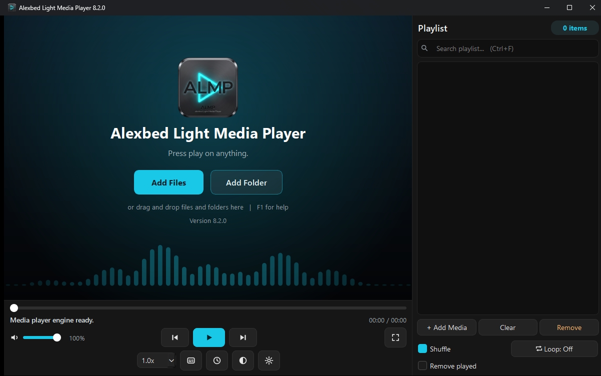
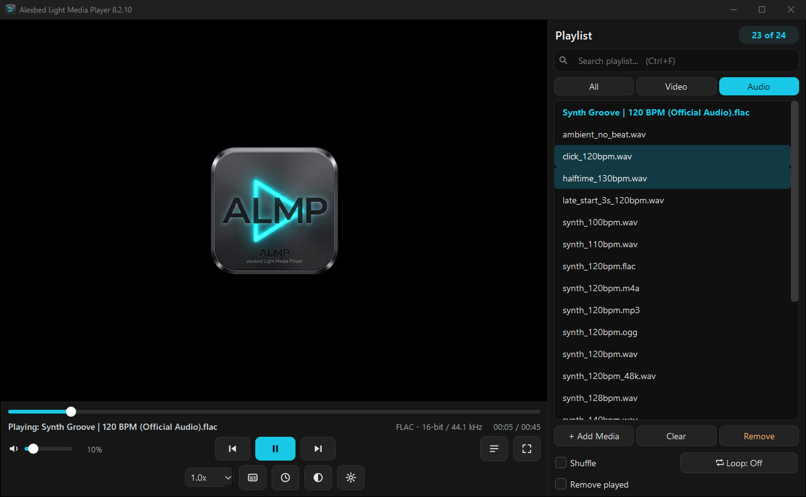
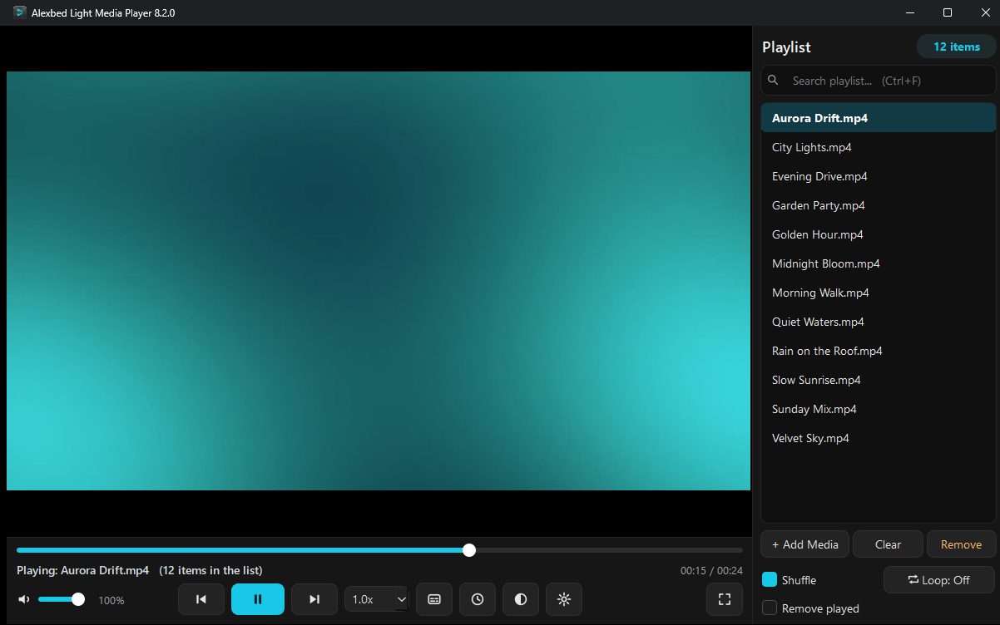
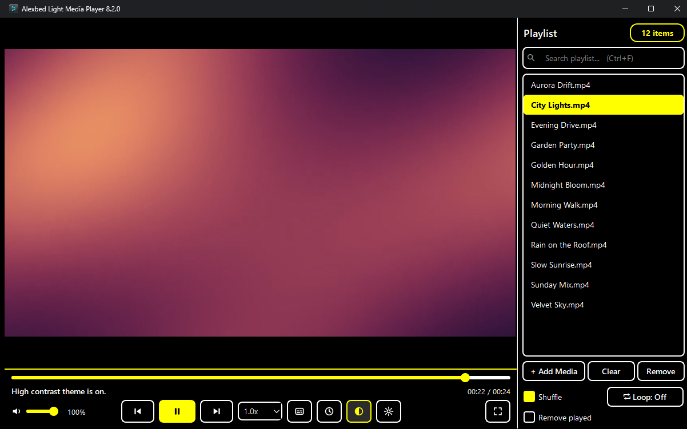
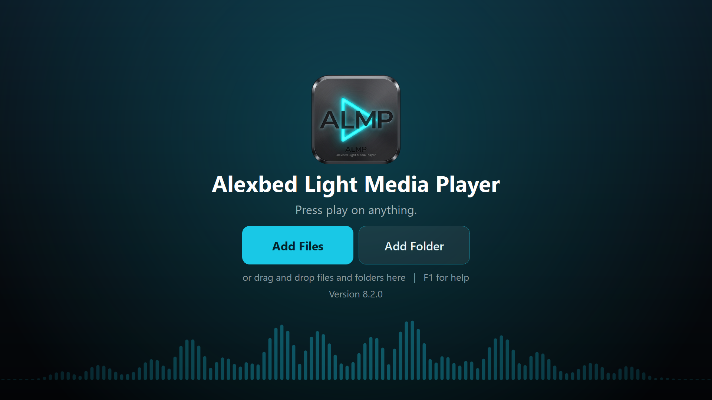
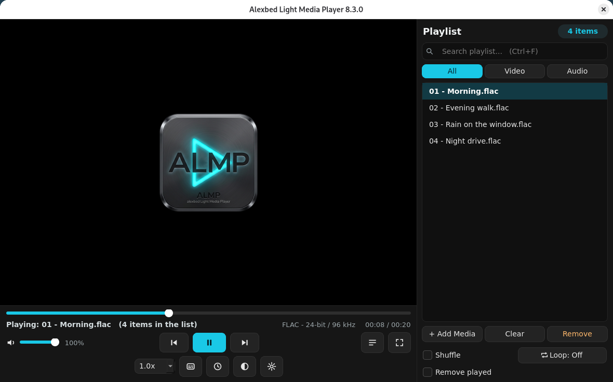

# Alexbed Light Media Player (ALMP)

A simple, free media player for Windows, built on the [mpv](https://mpv.io) playback engine.
ALMP (A-L-M-P, Alexbed Light Media Player) is not related to AIMP.
ALMP is made for people who just want to press play: big clear buttons, a dark modern look,
and no accounts, ads or tracking.







*High-contrast theme on:*





**Version:** 8.3.0 &nbsp;|&nbsp; **Author:** Alexander Bediako &nbsp;|&nbsp; **Licence:** [GPL-3.0-or-later](LICENSE)

**New in 8.3.0: ALMP for Linux.** A portable download for Linux Mint 22, Ubuntu 24.04, Debian 13 and newer:
unpack and run, nothing to install. See [Download and run (Linux)](#download-and-run-linux) and the
[release notes](docs/release-notes/v8.3.0.md). Nothing changes on Windows.

**New in 8.2.10:** clicking or dragging the seek bar lands where you point. Before, a video jumped to
the keyframe before that spot, up to several seconds early (6 s in one test). See the
[release notes](docs/release-notes/v8.2.10.md).

**New in 8.2.9:** the Settings window is readable again when Windows uses **light** mode (its page was
near-white under ALMP's light text). Dark mode looked right before and is unchanged. See the
[release notes](docs/release-notes/v8.2.9.md).

**New in 8.2.8:** one taskbar button: with ALMP pinned to the taskbar, playing a file no longer opens a second
ALMP button next to the pin. And no more freeze of about 14 s after opening a downloaded video whose name has
full-width characters such as "｜" (shown now as a plain "|"). See the
[release notes](docs/release-notes/v8.2.8.md).

**New in 8.2.7:** low-quality videos (720p and less) are sharpened automatically with the FSRCNNX shader, which
is now included (nothing is downloaded; HD videos are left alone; `E` turns it off and on to compare, and ALMP
turns it off by itself if the graphics card cannot keep up). Optional **ReplayGain** for music (off by default):
Automatic uses the album volume for an album played in order, the track volume otherwise. See the
[release notes](docs/release-notes/v8.2.7.md).

**New in 8.2.6:** the player's buttons keep working while Settings is open (in 8.2.5 they ignored the
mouse, in fullscreen too). See the [release notes](docs/release-notes/v8.2.6.md).

**New in 8.2.5:** select several playlist items at once (Ctrl+click, Shift+click, Ctrl+A) to remove them from the
list or delete the files in one go, and (for advanced users) your own video shaders: put mpv `.glsl` files such as
FSRCNNX or Anime4K in a `shaders` folder next to `ALMP.exe` and turn them on in Settings. ALMP includes no shaders and
downloads nothing. See the [release notes](docs/release-notes/v8.2.5.md).

**New in 8.2.4:** ALMP keeps all its files in a `Data` folder next to `ALMP.exe` (delete the folder and it is gone),
a small log that is cleared on close, *Show subtitles* (off until you turn it on), **All / Video / Audio** filter,
`Ctrl+S` saves only what is shown, the format of the playing track (e.g. *FLAC - 24-bit / 96 kHz*), optional gapless
playback and exclusive audio, video upscaling (Standard / Sharp / High quality), and a fix for the fullscreen controls
not appearing while music plays. See the [release notes](docs/release-notes/v8.2.4.md).

ALMP is free and will stay free. It is built to help people who need an easy, no-cost player,
and it is not a commercial product.

---

## Features

- **Plays almost anything.** Audio, video and playlists (`.m3u`, `.m3u8`, `.pls`), powered by mpv and FFmpeg.
- **Huge playlists, no waiting.** Drop a folder with 100,000 files: the first track starts at once while the rest
  is still being found, the count grows live, and **Stop adding** stops a long scan. The list on screen only draws
  the rows you can see, and search runs over a ready-made index. Measured numbers are in
  [Performance](#performance) below (and how to measure your own PC).
- **Search** by file or folder name as you type (`Ctrl+F`); every word must match. Enter plays the first match.
  **All / Video / Audio** buttons under the search box show one type of file (by file type, no disk reads),
  together with the search. **Save the playlist** (`Ctrl+S`) as `.m3u8`; with a search or filter on, only what
  is shown is saved.
- **Right-click a track** for *Play*, *Play next*, *Move up / down*, *Remove from list*, *Show in folder*,
  *Copy file path*, *Delete file...* and *Sort*. Right-click the video for play, tracks, subtitles and size.
- **Play next** queue, and **sorting** by name ("Track 2" before "Track 10", like Explorer), by folder, or reversed.
- **Starts clean.** ALMP does not remember the last playlist, so it opens fast and stays light.
- **Settings in one place** (gear button, `Ctrl+,`): high contrast, interface size, video size, *Remove played*,
  keep the playback speed, *Even out loud and quiet parts* (volume normaliser), volume up to 150%,
  show subtitles (remembered, off until you turn it on), subtitle size and a dark box behind subtitles,
  video upscaling (Standard / Sharp / High quality, mpv's own scalers), picture sharpening for low-quality videos
  (built-in FSRCNNX, or your own shaders from a `shaders` folder), ReplayGain (off by default; automatic / track / album), media keys in the background, *Run at Startup*, and
  **Make ALMP my default player** / **"Play with ALMP" and "Add to ALMP playlist"** when you right-click
  files (one or many) or a folder in Explorer (your Windows account only, can be undone).
- **High-contrast theme** (black, white and yellow) for every part of the window, including the welcome screen.
  The half-filled circle button on the control bar turns it on or off at once.
- **Interface sizes 100% to 200%** (*Apply now* restarts ALMP at the new size). At large sizes or on small
  screens the control bar switches to icons and two rows, so nothing is cut off.
- **Keyboard and screen readers.** Every control can be reached with Tab and has a name for screen readers.
  Space presses a focused button; the playlist keeps its arrow keys. Press `F1` for help.
- **Media keys in the background.** Play/Pause, Next and Previous keys work while you are in another program,
  and the Windows volume pop-up and lock screen show the track (Windows media controls). Can be switched off.
- **Sleep timer.** 5 minutes to 2 hours or *At the end of this track*; the sound fades out during the last minute;
  *+15 minutes* while it runs; then pause or close ALMP.
- **Playback speed** 0.5x to 2x; it stays for the next tracks until you close ALMP.
- **Optional:** continue films and audiobooks of 20 minutes or more where you stopped (off unless you switch it on;
  never the playlist).
- **Safe delete.** On your computer's own drives, *Delete file* sends the file to the Recycle Bin. USB sticks,
  memory cards and network drives have no Recycle Bin: there ALMP warns clearly that the file will be deleted
  permanently, and does nothing unless you say yes.
- **Single window.** Files opened from Explorer while ALMP runs are added (never wiping the playlist) and the first
  one plays. Selecting many files and pressing Enter works too.
- **Shuffle, loop and "remove played".** **Loop: Off / One / All** (`L`). Loop All switches "Remove played" off so
  the list never empties. The loop choice is not remembered. "Remove played" is off for new installs.
- **For music collections:** the playing bar shows the format of the playing track (for example
  *FLAC - 24-bit / 96 kHz*); optional **gapless playback** (the next track is read ahead) and optional
  **exclusive audio** (WASAPI exclusive, bit-perfect, for external DACs and AV receivers; other programs are
  silent while ALMP plays). Both are off unless you switch them on.
- **Album art**, hardware decoding, click-to-seek, floating fullscreen controls, audio tracks and subtitles,
  snapshots (`S`), Fit / Fill / Stretch (`A`).
- **Help and About** inside the app (version, licence, third-party notices, *Open log folder*).
- **Portable and offline.** No installer, no admin rights. ALMP never connects to the internet, has no
  auto-update and no telemetry. *Help > About* shows the address of the Releases page with a *Copy link*
  button (it only copies the text; ALMP does not open or check anything).
- **Leaves nothing behind.** ALMP keeps its settings and a small log in a `Data` folder next to `ALMP.exe`, so
  deleting the ALMP folder removes everything. Only if that folder cannot be written to (for example in
  Program Files) does ALMP use `%APPDATA%\ALMP` and `%LOCALAPPDATA%\ALMP` instead (Settings says so).
  Files from versions before 8.2.4 are moved into `Data` once. The Windows entries for Default apps, the
  right-click menu and Run at Startup only exist if you turn them on, and can be removed in Settings or with
  `Remove-ALMP-Defaults.bat`.
- **Small log, cleared on close.** The log (at most 256 KB) is deleted when ALMP closes normally, unless
  something went wrong during that run (then it is kept so the problem can be looked at). Settings >
  *Privacy and files* can keep the last run or switch the log off. It is never sent anywhere.

## Download and run (Windows)

1. Open the [Releases](../../releases) page and download the latest `.zip`.
2. Extract the whole folder (do not run ALMP from inside the zip).
3. Double-click `ALMP.exe`.

> **ALMP is not code-signed.** Windows SmartScreen may show "Windows protected your PC" the first time.
> This warning appears for most new free programs that are not signed; it does not mean a virus was found.
> Only download ALMP from this repository's [Releases](../../releases) page. Then click **More info** and **Run anyway**.
>
> **Check your download first (recommended).** Each release page lists the zip's SHA-256 checksum. In the Downloads folder,
> open PowerShell and run `Get-FileHash .\ALMP-v8.3.0-Portable.zip -Algorithm SHA256`
> (or in Command Prompt: `certutil -hashfile ALMP-v8.3.0-Portable.zip SHA256`).
> The long code it prints must match the release page exactly (capital or small letters do not matter). If it does not match,
> do not run the file. See [SIGNING.md](SIGNING.md) for why ALMP is not signed yet.

### Make ALMP your default player

1. Copy the ALMP folder to your computer (for example, `Documents`), not a USB stick.
2. In ALMP, click the **gear** button and then **Make ALMP my default player...**
   (or double-click `Set-ALMP-Defaults.bat` inside the ALMP folder and press **Y**).
3. On the Windows page that opens, press **Set default** (or pick ALMP for `.mp3`, `.mp4`, and so on).

Windows does not allow any program to change your defaults silently, so this last click must be yours.

### Remove ALMP (uninstall)

Run `Remove-ALMP-Defaults.bat`. It removes ALMP from *Open with* and *Default apps*, the "Play with ALMP" /
"Add to ALMP playlist" right-click entries, turns off *Run at Startup*,
and asks whether to delete ALMP's settings and log files too. Then delete the ALMP folder.

## Download and run (Linux)



ALMP for Linux is **portable, like the Windows zip: nothing to install.** The playback engine (mpv with
its FFmpeg libraries) is inside the folder.

1. Download `ALMP-vX.Y.Z-Linux-x86_64.tar.gz` from the [Releases](../../releases) page.
2. Right-click it > *Extract Here* (or `tar xzf ALMP-vX.Y.Z-Linux-x86_64.tar.gz`).
3. Open the new folder and double-click `ALMP` (or run `./ALMP-vX.Y.Z-Linux-x86_64/ALMP`).

Check the download first: `sha256sum -c ALMP-vX.Y.Z-Linux-x86_64.tar.gz.sha256.txt` must print `OK`.

- **Runs on** 64-bit PCs with Linux Mint 22, Ubuntu 24.04, Debian 13 and newer (glibc 2.39 or later:
  `ldd --version`). Older systems (Ubuntu 22.04, Debian 12) are not supported by this build.
- **Uses from your system** (every desktop Linux has them): the graphics driver, PipeWire or PulseAudio,
  D-Bus, fonts, GLib. On a Wayland desktop ALMP runs through XWayland so the video stays inside its window.
- **In Settings > Linux:** add ALMP to the app menu and "Open With", make it the default player (60 audio
  and video types), start at sign-in, and background media keys (MPRIS: keyboard media keys and the desktop's
  media controls). *Exclusive audio* sends the sound straight to a device (for example HDMI to a TV or
  receiver), bit-perfect, or through PipeWire in exclusive mode.
- **Tested** on Debian 13 (GNOME, Xorg and Wayland), Ubuntu 26.04 (GNOME Wayland, without any mpv installed)
  and Linux Mint 22.3 (Cinnamon) on a real PC, with real mouse/keyboard input. See [docs/LINUX.md](docs/LINUX.md).
- **Not tested:** KDE, Xfce, Fedora, Arch, HiDPI screens, NVIDIA/AMD graphics, real USB sticks (Trash),
  drag and drop of files.
- **Differences from Windows:** the window frame is drawn by your desktop (dark on Cinnamon; GNOME keeps its
  own); no right-click entries in the file manager (use "Open With"); files go to your desktop's Trash.

## Keyboard shortcuts

| Key | Action |
|---|---|
| Space | Play / pause (when a button has the focus, Space presses that button) |
| F, Esc | Fullscreen / leave fullscreen |
| Left / Right | Seek 5 seconds |
| Up / Down | Volume (in the playlist: move up and down the list) |
| Page Up / Page Down | Previous / next track |
| M | Mute |
| A | Video size: Fit, Fill, Stretch |
| S | Save a picture of the video (to Pictures) |
| P | Show / hide the playlist drawer (fullscreen) |
| L | Loop: Off, One (this track), All (whole playlist) |
| E | Picture sharpening off / on (low-quality videos), to compare |
| Ctrl+F | Search the playlist (Down goes to the list, Esc clears) |
| Ctrl+O / Ctrl+Shift+O | Add files / add a folder |
| Ctrl+S | Save the playlist (only the shown items when a search or filter is on) |
| Ctrl+, | Settings |
| Enter | Play the selected playlist item |
| Delete / Shift+Delete | Remove from the list / delete the file (asks first) |
| Ctrl+click, Shift+click, Ctrl+A | Select several playlist items (then Delete, Shift+Delete or right-click) |
| Menu key, Shift+F10 | Right-click menu for the selected item |
| Tab | Move between controls (the selected one gets a yellow outline; cyan in high contrast) |
| F1 | Help |
| Double-click video | Fullscreen |

## Performance

Measured with `tools/bench_playlist.py` on GitHub Actions runners (4 virtual CPUs, Qt 6.12 offscreen,
Python 3.13, mpv replaced by a stand-in, empty generated files), CI run 41499364586 on commit `fe7dfd0`.
These are server machines, not an old home PC: **run the script on your own PC** (see below) before quoting
numbers for slower hardware.

**Real PC check (v8.1.0 build, Windows 11 desktop, real mpv, 100,120 playable mp3 files in 401 folders on a local drive):**
the first track was playing less than 1 s after choosing the folder, about 28,000 files were listed after 1 s, all of them
after about 4 s (timed by screenshots, so only accurate to about a second). The window kept responding while loading;
searching "song 0999" showed its matches at once, and scrolling or dragging the scrollbar across the whole list was smooth.
Not measured yet: USB sticks and network shares (the drive's speed limits those), and exact millisecond pauses on a real PC.

| Measured | Linux runner | Windows runner |
|---|---|---|
| Folder with 100,000 files: first track handed to the player | 0.06 s | 0.09 s |
| Folder with 100,000 files: all in the list | 1.2 s | 1.6 s |
| Longest window-thread stall while loading those 100,000 (5 ms heartbeat) | 61 ms (1 tick over 50 ms) | 148 ms (2 ticks over 50 ms) |
| Adding 5,000 rows to the list (median / worst), 100,000 rows | 3.4 / 7.4 ms | 4.2 / 8.1 ms |
| Same at 250,000 rows | 3.9 / 8.8 ms | 4.8 / 9.6 ms |
| Search, 100,000 files ("love" / "e" / no match) | 6.5 / 8.1 / 6.0 ms | 8.4 / 10.7 / 6.2 ms |
| Search, 250,000 files (same queries; worst query measured 33-44 ms) | 12.5 / 16.9 / 14.5 ms | 19.0 / 24.6 / 15.4 ms |
| Typing one more letter (refined search), 250,000 | 2.7 ms | 3.8 ms |
| Jump to a random row and repaint (average / worst) | 2.0 / 2.6 ms | 2.9 / 4.4 ms |
| Natural sort of 250,000 by name (background thread) + applying it | 2.7 s + 31 ms | 2.7 s + 39 ms |
| Memory growth of the list data: 100,000 / 250,000 entries | 34 / 59 MB | 28 / 59 MB (run 41499999014) |
| Whole window after scanning 100,000 files (process memory) | 127 -> 159 MB | 107 -> 141 MB (run 41499999014) |

Why a table and not a list: with the same model, Qt's `QListView` needed a median of 115 ms (Linux) / 112 ms
(Windows) to add 5,000 rows to a 100,000-row list because it re-positions every row; the one-column table that
ALMP now uses needed 3.5 / 4.0 ms (also measured by the script, "view comparison").

Honest summary: the targets "first track playable in under 1 s" and "100,000-file search under 100 ms" were met
on these machines; "the window never blocks more than 50 ms" was **not quite** met during a 100,000-file scan
(one or two pauses of 61-148 ms in run 41499364586; 34 ms and 83 ms in the next run 41499999014, so it varies). The search itself runs on the window thread after a short pause in
typing (150-250 ms), which is fast enough at these sizes.

Measure your own PC (no screen, no sound, files are created in a temporary folder and deleted again):

```bash
pip install -r requirements.txt
python tools/bench_playlist.py --sizes 100000,250000 --disk-sizes 100000 --json my-pc.json
```

## Run from source

You need Python 3.10 or newer (the GitHub Actions build uses Python 3.13) and the mpv library (`libmpv`).

```bash
git clone https://github.com/alexbedca/Alexbed-Light-Media-Player.git
cd Alexbed-Light-Media-Player
python -m venv venv
venv\Scripts\activate          # Linux: source venv/bin/activate
pip install -r requirements.txt
python main.py
```

Tests: `pip install pytest ruff` then `python -m pytest tests` and `ruff check .`. With PyQt6 installed the
window tests run too (offscreen, mpv replaced by a stand-in); without it only the plain-logic tests run.
Benchmark: `python tools/bench_playlist.py` (see [Performance](#performance)).

The code is in the `almp/` package (`main.py` only starts it): plain logic that is tested on its own
(`logic.py`, `store.py`, `naturalsort.py`, `settings.py`, `media.py`, `scanner.py`), the list model, the mpv
options, Windows-only calls (`platform_win.py`, `smtc.py`, every call guarded) and the window (`ui.py`).

- **Windows:** put `mpv-2.dll` (a libmpv build) in a folder named `runtime` next to `main.py`.
- **Linux:** `sudo apt install libmpv2 libxcb-cursor0 libxkbcommon-x11-0 libxcb-icccm4 libxcb-keysyms1 libxcb-xkb1`
  (only for running from source; the release tarball brings its own). ALMP uses X11 (XWayland on Wayland)
  because mpv embeds into the window that way. Building the Linux tarball: see [docs/LINUX.md](docs/LINUX.md).

### Build the portable app

Run `pip install nuitka`, then `Build-ALMP.bat`. It reads the version from `__version__` in `almp/__init__.py`
(via `tools/get_version.py`), runs the full Nuitka command (see the file for every option) and writes `build.log`.
`Package-ALMP.bat` then makes `release\ALMP-vX.Y.Z-Portable.zip` (with `LICENSES\`) and its SHA-256 file.
The GitHub Actions workflow (`.github/workflows/build.yml`) does the same on GitHub's servers with a pinned,
checksum-verified libmpv and writes `BUILD-INFO.txt` into the zip.

The core of the command is:

```bat
python -m nuitka --standalone --enable-plugin=pyqt6 --windows-console-mode=disable --lto=yes ^
  --windows-icon-from-ico=icon.ico --include-data-file=icon.ico=icon.ico ^
  --include-data-file=icon.png=icon.png --include-data-file=runtime/mpv-2.dll=runtime/mpv-2.dll ^
  --include-package=almp --output-filename=ALMP.exe main.py
```

## Contributing

Bug reports, ideas and pull requests are welcome. Please open an issue first for larger changes.
By contributing you agree that your work is released under the same licence as the project.

## Licence

ALMP is free software, released under the **GNU General Public License v3.0 or later**.
You may use, study, share and change it. See [LICENSE](LICENSE).

ALMP is built on other free software (PyQt6, Qt, mpv, FFmpeg, mutagen and others).
Their licences are listed in [THIRD-PARTY-NOTICES.txt](THIRD-PARTY-NOTICES.txt), and the full licence texts
are in the [LICENSES](LICENSES) folder (also included in the zip).

## Code signing

ALMP releases are currently **not code-signed**. The application for free signing from the
SignPath Foundation was declined for now, because the project does not yet have enough public visibility.
Reapplying later, or a paid option, is still open. Until then, please check each download with its published SHA-256
(see above). Details: [SIGNING.md](SIGNING.md).

**Privacy:** ALMP works fully offline. It does not send any information to other computers or networks.
Settings and the small log stay in the `Data` folder next to `ALMP.exe` (or in `%APPDATA%\ALMP` and
`%LOCALAPPDATA%\ALMP` when that folder cannot be written to).

## Community & Roadmap
- See [ROADMAP.md](ROADMAP.md) for what is coming next.
- See [CONTRIBUTING.md](CONTRIBUTING.md) if you want to help.
- See [SECURITY.md](SECURITY.md) to report a security issue.
