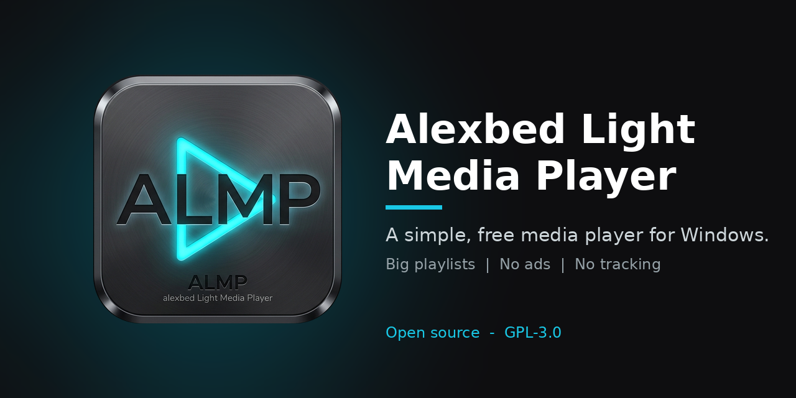

# Alexbed Light Media Player (ALMP)

A simple, free media player for Windows, built on the [mpv](https://mpv.io) playback engine.
ALMP is made for people who just want to press play: big clear buttons, a dark modern look,
and no accounts, ads or tracking.



**Version:** 7.2.0 &nbsp;|&nbsp; **Author:** Alexander Bediako &nbsp;|&nbsp; **Licence:** [GPL-3.0-or-later](LICENSE)

ALMP is free and will stay free. It is built to help people who need an easy, no-cost player,
and it is not a commercial product.

---

## Features

- **Plays almost anything.** Audio, video and playlists (`.m3u`, `.m3u8`, `.pls`), powered by mpv and FFmpeg.
- **Large playlists.** Folders load in batches so the window stays responsive. A search box filters the list as you type.
- **Drag and drop.** Drop files or folders on the window to add them to the playlist.
- **Double-click to play.** Run `Set-ALMP-Defaults.bat` once to register ALMP with Windows, then choose it in *Default apps*.
- **Single window.** Opening another file while ALMP is running sends it to the same window.
- **Shuffle, loop and "remove played".** Shuffle picks a random track each time. With *Remove played* switched off, a track can repeat.
- **Album art** from embedded tags (MP3, FLAC, M4A).
- **Hardware decoding** when your graphics card supports it (mpv `hwdec=auto`).
- **Fullscreen controls that float over the video.** The control bar and the playlist drawer appear together when you move the mouse and hide together after 3 seconds.
- **Video size modes.** Press `A` to cycle Fit, Fill (crop) and Stretch.
- **Interface size.** Choose 100% to 200% in the playlist panel (applies the next time you open ALMP).
- **Remembers your settings** (volume, shuffle, loop, remove played, interface size).
- **Windows media keys** (play/pause, next, previous) work.
- **Portable.** No installer, no admin rights. ALMP does not connect to the internet.

## Download and run (Windows)

1. Open the [Releases](../../releases) page and download the latest `.zip`.
2. Extract the whole folder (do not run ALMP from inside the zip).
3. Double-click `ALMP.exe`.

> **Windows SmartScreen:** ALMP is not code-signed, so Windows may show "Windows protected your PC".
> Click **More info** then **Run anyway**. You can check the download against the SHA-256 checksum published with each release.

### Make ALMP your default player

1. Copy the ALMP folder to your computer (for example, `Documents`), not a USB stick.
2. Double-click `Set-ALMP-Defaults.bat` inside the ALMP folder and press **Y**.
3. On the Windows page that opens, press **Set default** (or pick ALMP for `.mp3`, `.mp4`, and so on).

Windows does not allow any program to change your defaults silently, so this last click must be yours.
To undo it, run `Remove-ALMP-Defaults.bat`.

## Keyboard shortcuts

| Key | Action |
|---|---|
| Space | Play / pause |
| F, Esc | Fullscreen / leave fullscreen |
| Left / Right | Seek 5 seconds |
| Up / Down | Volume |
| Page Up / Page Down | Previous / next track |
| M | Mute |
| A | Video size: Fit, Fill, Stretch |
| P | Show / hide the playlist drawer (fullscreen) |
| Ctrl+F | Search the playlist |
| Double-click video | Fullscreen |

## Run from source

You need Python 3.10 or newer and the mpv library (`libmpv`).

```bash
git clone https://github.com/alexbedca/Alexbed-Light-Media-Player.git
cd Alexbed-Light-Media-Player
python -m venv venv
venv\Scripts\activate          # Linux: source venv/bin/activate
pip install -r requirements.txt
python main.py
```

- **Windows:** put `mpv-2.dll` (a libmpv build) in a folder named `runtime` next to `main.py`.
- **Linux (experimental, tested on Ubuntu under WSL only):** `sudo apt install libmpv2 libxcb-cursor0 libxkbcommon-x11-0 libxcb-icccm4 libxcb-keysyms1 libxcb-xkb1`. ALMP uses X11 on Linux because mpv embeds into the window that way.

### Build the portable app

```bat
pip install nuitka
python -m nuitka --standalone --enable-plugin=pyqt6 --windows-console-mode=disable ^
  --windows-icon-from-ico=icon.ico --include-data-file=icon.ico=icon.ico ^
  --include-data-file=icon.png=icon.png --include-data-dir=runtime=runtime ^
  --output-filename=ALMP main.py
```

## Contributing

Bug reports, ideas and pull requests are welcome. Please open an issue first for larger changes.
By contributing you agree that your work is released under the same licence as the project.

## Licence

ALMP is free software, released under the **GNU General Public License v3.0 or later**.
You may use, study, share and change it. See [LICENSE](LICENSE).

ALMP is built on other free software (PyQt6, Qt, mpv, FFmpeg, mutagen and others).
Their licences are listed in [THIRD-PARTY-NOTICES.txt](THIRD-PARTY-NOTICES.txt).

## Community & Roadmap
- See [ROADMAP.md](ROADMAP.md) for what is coming next.
- See [CONTRIBUTING.md](CONTRIBUTING.md) if you want to help.
- See [SECURITY.md](SECURITY.md) to report a security issue.
