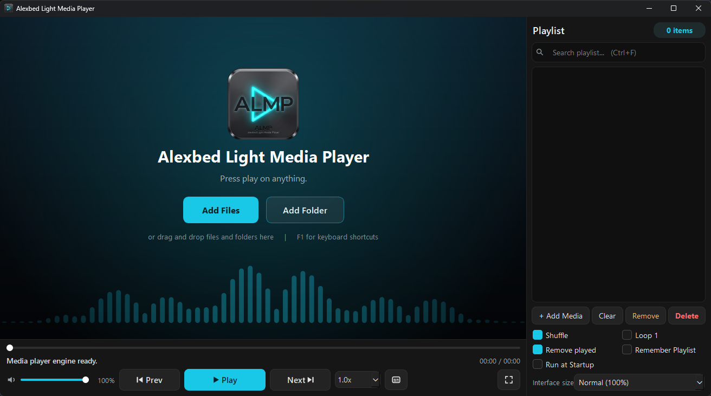
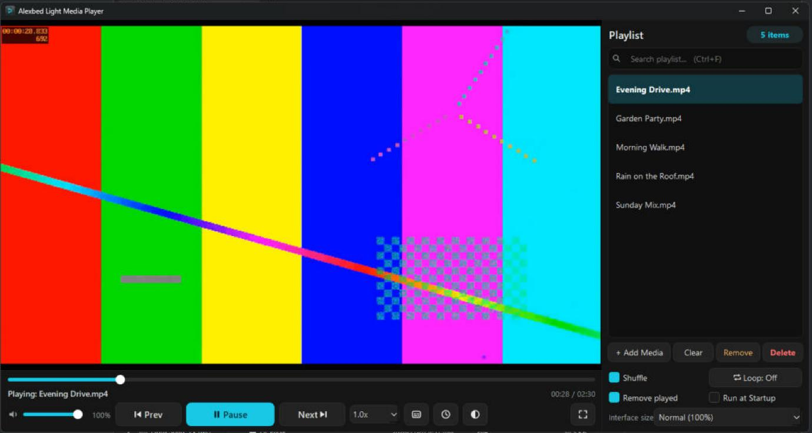
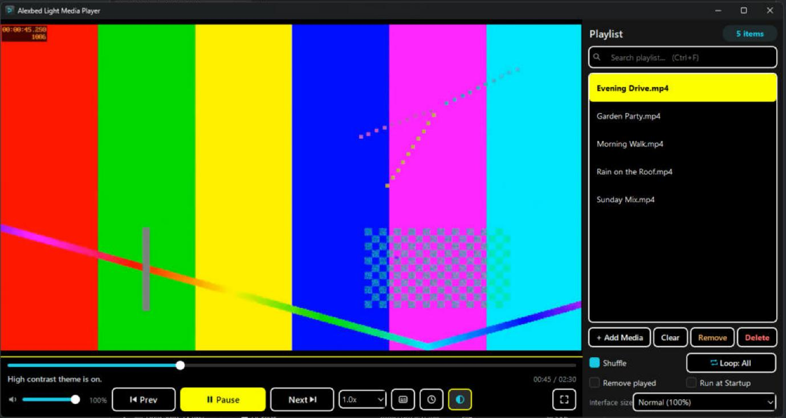

# Alexbed Light Media Player (ALMP)

A simple, free media player for Windows, built on the [mpv](https://mpv.io) playback engine.
ALMP is made for people who just want to press play: big clear buttons, a dark modern look,
and no accounts, ads or tracking.





*High-contrast theme on, with Loop: All ("Remove played" is switched off automatically):*



**Version:** 8.1.0 &nbsp;|&nbsp; **Author:** Alexander Bediako &nbsp;|&nbsp; **Licence:** [GPL-3.0-or-later](LICENSE)

ALMP is free and will stay free. It is built to help people who need an easy, no-cost player,
and it is not a commercial product.

---

## Features

- **Plays almost anything.** Audio, video and playlists (`.m3u`, `.m3u8`, `.pls`), powered by mpv and FFmpeg.
- **Starts clean.** ALMP does not remember the last playlist or position, so it opens fast and stays light.
- **Large playlists.** Folders load in batches so the window stays responsive. A search box filters the list as you type (tested with a 10,000-file library).
- **Save your playlist** as an `.m3u8` file (*Add Media > Save Playlist as M3U*) and load it again later.
- **Sleep timer.** Click the clock button on the control bar, choose 5 minutes to 2 hours, then pick what happens: pause playback, or close ALMP. The clock turns blue while a timer is running.
- **High-contrast theme** (black, white and yellow) for easier reading. Click the half-filled circle button on the
  control bar (next to the clock) to turn it on or off; it turns blue while it is on. Also in *Add Media > High Contrast Theme*.
- **Drag and drop.** Drop files or folders on the window to add them to the playlist.
- **Safe delete.** On your computer's own drives, *Delete* sends the file to the Recycle Bin, so a mistake can be undone.
  USB sticks, memory cards and network drives have no Recycle Bin: there ALMP warns you clearly that the file will be
  deleted permanently, and does nothing unless you say yes.
- **Double-click to play.** Run `Set-ALMP-Defaults.bat` once to register ALMP with Windows, then choose it in *Default apps*.
- **Single window.** Files you open from Explorer while ALMP is running are added to the playlist in the same window,
  and the first of them starts playing. The playlist is never wiped. Selecting many files and pressing Enter works too.
- **Shuffle, loop and "remove played".** The loop button (or `L`) switches between **Loop: Off** (stop after the
  last track), **Loop: One** (the track that is playing repeats until you press Next, Prev or pick another one) and
  **Loop: All** (the whole playlist starts again; with Shuffle on, every track plays once per round). Loop All
  switches "Remove played" off (unticked and greyed out) so the list never empties; when you leave Loop All it
  goes back to how you had it. The loop choice is not remembered: it is always Off when ALMP starts.
- **Album art** from embedded tags (MP3, FLAC, M4A).
- **Hardware decoding** when your graphics card supports it (mpv `hwdec=auto`).
- **Fullscreen controls that float over the video**, hiding after 3 seconds (they stay up, with the mouse pointer, while a menu or window is open).
- **Click anywhere on the progress bar** to jump there.
- **Audio tracks and subtitles.** The button next to the speed box lists audio tracks, subtitles, loads a subtitle file and takes snapshots (`S`).
- **Video size modes.** Press `A` to cycle Fit, Fill (crop) and Stretch.
- **Interface size.** Choose 100% to 200% in the playlist panel (applies the next time you open ALMP).
- **Remembers your settings** (volume, shuffle, remove played, interface size, high contrast). Loop is not remembered.
- **Windows media keys** (play/pause, next, previous) work while the ALMP window is the active window.
- **Portable and offline.** No installer, no admin rights. ALMP does not connect to the internet.
- **Error log on your PC only.** If something goes wrong, ALMP keeps running and writes a short report to
  `%LOCALAPPDATA%\ALMP\almp.log`. It is never sent anywhere; attach it to a bug report if you like.

## Download and run (Windows)

1. Open the [Releases](../../releases) page and download the latest `.zip`.
2. Extract the whole folder (do not run ALMP from inside the zip).
3. Double-click `ALMP.exe`.

> **ALMP is not code-signed.** Windows SmartScreen may show "Windows protected your PC" the first time.
> This warning appears for most new free programs that are not signed; it does not mean a virus was found.
> Only download ALMP from this repository's [Releases](../../releases) page. Then click **More info** and **Run anyway**.
>
> **Check your download first (recommended).** Each release page lists the zip's SHA-256 checksum. In the Downloads folder,
> open PowerShell and run `Get-FileHash .\ALMP-v8.1.0-Portable.zip -Algorithm SHA256`
> (or in Command Prompt: `certutil -hashfile ALMP-v8.1.0-Portable.zip SHA256`).
> The long code it prints must match the release page exactly (capital or small letters do not matter). If it does not match,
> do not run the file. See [SIGNING.md](SIGNING.md) for why ALMP is not signed yet.

### Make ALMP your default player

1. Copy the ALMP folder to your computer (for example, `Documents`), not a USB stick.
2. Double-click `Set-ALMP-Defaults.bat` inside the ALMP folder and press **Y**.
3. On the Windows page that opens, press **Set default** (or pick ALMP for `.mp3`, `.mp4`, and so on).

Windows does not allow any program to change your defaults silently, so this last click must be yours.

### Remove ALMP (uninstall)

Run `Remove-ALMP-Defaults.bat`. It removes ALMP from *Open with* and *Default apps*, turns off *Run at Startup*,
and asks whether to delete ALMP's settings and log files too. Then delete the ALMP folder.

## Keyboard shortcuts

| Key | Action |
|---|---|
| Space | Play / pause |
| F, Esc | Fullscreen / leave fullscreen |
| Left / Right | Seek 5 seconds |
| Up / Down | Volume |
| Page Up / Page Down | Previous / next track |
| M | Mute |
| A | Video size: Fit, Fill, Stretch |
| S | Save a picture of the video (to Pictures) |
| P | Show / hide the playlist drawer (fullscreen) |
| L | Loop: Off, One (this track), All (whole playlist) |
| Ctrl+F | Search the playlist |
| Enter | Play the selected playlist item |
| Tab | Move between buttons (the selected one gets a yellow outline) |
| F1 | Show the shortcut help |
| Double-click video | Fullscreen |

## Run from source

You need Python 3.10 or newer (the GitHub Actions build uses Python 3.13) and the mpv library (`libmpv`).

```bash
git clone https://github.com/alexbedca/Alexbed-Light-Media-Player.git
cd Alexbed-Light-Media-Player
python -m venv venv
venv\Scripts\activate          # Linux: source venv/bin/activate
pip install -r requirements.txt
python main.py
```

To run the small logic tests (no window is opened): `pip install pytest` then `python -m pytest tests`.

- **Windows:** put `mpv-2.dll` (a libmpv build) in a folder named `runtime` next to `main.py`.
- **Linux (experimental, tested on Ubuntu under WSL only):** `sudo apt install libmpv2 libxcb-cursor0 libxkbcommon-x11-0 libxcb-icccm4 libxcb-keysyms1 libxcb-xkb1`. ALMP uses X11 on Linux because mpv embeds into the window that way.

### Build the portable app

Run `pip install nuitka`, then `Build-ALMP.bat`. It reads the version from `__version__` in `main.py`
(via `tools/get_version.py`), runs the full Nuitka command (see the file for every option) and writes `build.log`.
`Package-ALMP.bat` then makes `release\ALMP-vX.Y.Z-Portable.zip` (with `LICENSES\`) and its SHA-256 file.
The GitHub Actions workflow (`.github/workflows/build.yml`) does the same on GitHub's servers with a pinned,
checksum-verified libmpv and writes `BUILD-INFO.txt` into the zip.

The core of the command is:

```bat
python -m nuitka --standalone --enable-plugin=pyqt6 --windows-console-mode=disable --lto=yes ^
  --windows-icon-from-ico=icon.ico --include-data-file=icon.ico=icon.ico ^
  --include-data-file=icon.png=icon.png --include-data-file=runtime/mpv-2.dll=runtime/mpv-2.dll ^
  --output-filename=ALMP.exe main.py
```

## Contributing

Bug reports, ideas and pull requests are welcome. Please open an issue first for larger changes.
By contributing you agree that your work is released under the same licence as the project.

## Licence

ALMP is free software, released under the **GNU General Public License v3.0 or later**.
You may use, study, share and change it. See [LICENSE](LICENSE).

ALMP is built on other free software (PyQt6, Qt, mpv, FFmpeg, mutagen and others).
Their licences are listed in [THIRD-PARTY-NOTICES.txt](THIRD-PARTY-NOTICES.txt), and the full licence texts
are in the [LICENSES](LICENSES) folder (also included in the zip).

## Code signing

ALMP releases are currently **not code-signed**. The application for free signing from the
SignPath Foundation was declined for now, because the project does not yet have enough public visibility.
Reapplying later, or a paid option, is still open. Until then, please check each download with its published SHA-256
(see above). Details: [SIGNING.md](SIGNING.md).

**Privacy:** ALMP works fully offline. It does not send any information to other computers or networks.
Settings and the error log stay on your PC (`%APPDATA%\ALMP` and `%LOCALAPPDATA%\ALMP`).

## Community & Roadmap
- See [ROADMAP.md](ROADMAP.md) for what is coming next.
- See [CONTRIBUTING.md](CONTRIBUTING.md) if you want to help.
- See [SECURITY.md](SECURITY.md) to report a security issue.
