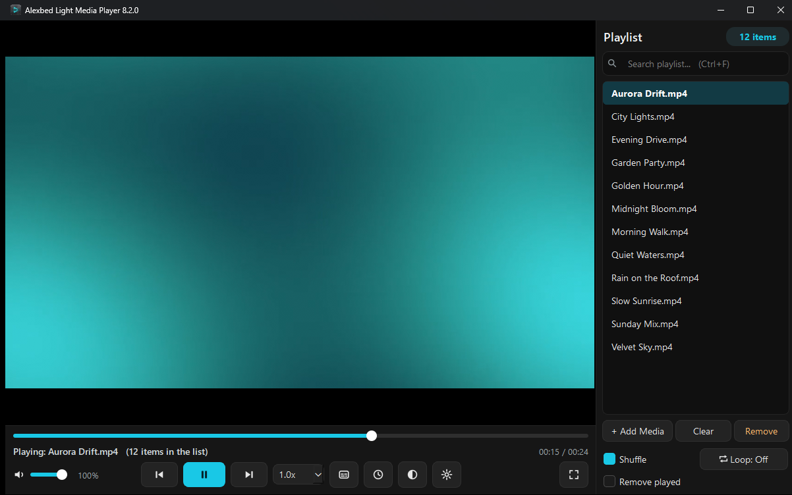
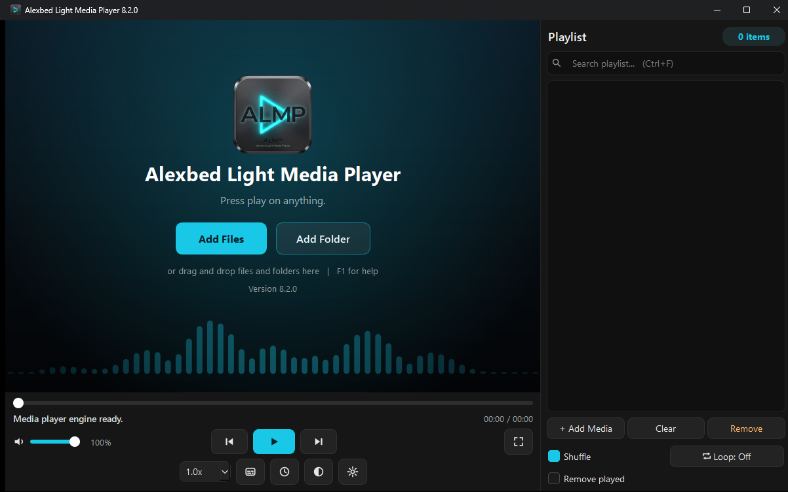
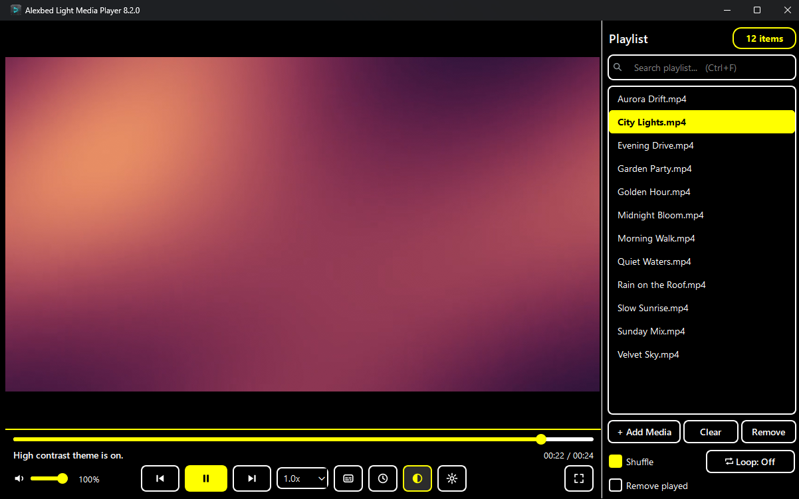

# ALMP v8.1.0

> **Never published on its own.** Everything below is part of [v8.2.0](v8.2.0.md); please download v8.2.0.

**Download:** `ALMP-v8.1.0-Portable.zip`
**SHA-256:** A65A2224C3D77F399D4127E584E04AC1E6D4C4E6A2380205B22D890CDAAB6EC2

ALMP 8.1 is about big playlists, one simple Settings window and finishing accessibility.
**It also contains everything from the planned v8.0.1 safety update** (see the first section below);
v8.0.1 was never published on its own, so everyone on v8.0.0 should update straight to 8.1.0.
It still starts clean (no playlist is ever restored), the loop choice is still never remembered,
and ALMP still never connects to the internet.

## Safety and reliability (from v8.0.1)
- **Delete on USB sticks, memory cards and network drives** now warns clearly that the file is deleted permanently
  (these drives have no Recycle Bin); on your computer's own drives the file still goes to the Recycle Bin.
- ALMP no longer closes suddenly after an unexpected error; it keeps running and writes a short log
  (`%LOCALAPPDATA%\ALMP\almp.log`).
- Several files opened from Explorer at once all reach the same window; the "Remember Playlist" box that did not
  work is gone (ALMP always starts clean); old "ANSI" `.m3u` playlists load correctly.
- High-contrast button on the control bar, three-way loop (Off / One / All, key `L`, never remembered).
- Details: [v8.0.1 notes](v8.0.1.md).

## Big playlists
- **The first track starts at once** when you drop a big folder, while the rest is still being found.
  The status line and the count show how many files are in the list so far, and **Stop adding** stops a long scan.
- **The playlist on screen only draws the rows you can see**, so 100,000 or 250,000 files scroll smoothly.
- **Search is much faster** (a ready-made search index; typing more letters only searches the previous matches),
  and it looks in folder names too. Every word you type must match.
- **Natural sort** ("Track 2" before "Track 10", like Explorer): right-click > *Sort the playlist* (by name,
  by folder, or reversed). Sorting runs in the background.
- Measured on GitHub's build machines (not on a real home PC yet): a 100,000-file folder had its first track ready
  in under 0.1 s and was fully listed in 1.2-1.6 s; searching 100,000 names took under 20 ms. Details, and how to
  measure your own PC, in the README (*Performance*). One known gap: during that scan the window still paused
  once or twice for 61-148 ms.

## New
- **Settings window** (gear button on the control bar, or `Ctrl+,`) with everything in one place: high contrast,
  interface size (*Apply now* restarts ALMP at the new size), video size (remembered), *Remove played*,
  keep the playback speed, **Even out loud and quiet parts** (volume normaliser), **volume up to 150%**,
  **subtitle size** and a **dark box behind subtitles**, media keys in the background, *Run at Startup*.
- **Make ALMP my default player** button (no black window), and an optional **"Play with ALMP"** entry when you
  right-click a folder in Explorer. Both change your Windows account only and can be undone in Settings or with
  `Remove-ALMP-Defaults.bat`.
- **Right-click menu on the playlist:** Play, **Play next**, Move up / down, Remove from list, Show in folder,
  Copy file path, Delete file..., Sort, Add, Clear. Right-click on the video: play, tracks, subtitles, size, fullscreen.
- **Play next** queue (shown as `[next]` in the list); it goes before the normal order and shuffle.
- **Media keys while ALMP is in the background**, and the track name with Play/Pause/Next/Previous in the Windows
  volume pop-up and on the lock screen (Windows media controls). If this cannot start on a PC, ALMP goes on
  without it (keys then work while ALMP is in front) and says so in Settings.
- **Sleep timer:** *At the end of this track*, a gentle fade-out during the last minute, and *+15 minutes*.
- **Playback speed** 0.75x and 1.25x added; the speed now stays for the next tracks until you close ALMP.
- **Optional, off by default:** *Continue long files where I stopped* (only files of 20 minutes or more, at most 200,
  on this PC only; turning it off forgets them). The playlist is still never restored.
- **Help** (`F1`: "How do I..." and keyboard) and **About** (version, licence, third-party notices, *Open log folder*).
  The version is shown in the window title and on the welcome screen.
- Keys: `Ctrl+O` add files, `Ctrl+Shift+O` add folder, `Delete` remove from list, `Shift+Delete` delete file,
  Menu key for the right-click menu, Esc clears the search, Down goes from the search box to the list.

## Changed
- **"Remove played" is now off for new installs** (people who used 8.0.x keep their own choice).
- **The red Delete button left the playlist panel.** Deleting a file is in the right-click menu (and `Shift+Delete`),
  with exactly the same safety questions as before (Recycle Bin on your own drives, a clear "permanently" warning
  on USB sticks, memory cards and network drives). *Remove* (take off the list, keep the file) is still a button.
- *Run at Startup* and *Interface size* moved from the playlist panel to Settings.
- **High contrast now covers everything**, including the status line, time, volume, the item count, the playlist
  title and the welcome screen (black with yellow bars), and the playing track is yellow.
- **The control bar fits small screens at 150-200%:** when there is not enough room the buttons show icons only and
  the tool buttons move to a second row. The window never opens bigger than the screen.
- **Keyboard:** Space presses the focused button (before, it always toggled playback); the playlist keeps
  Up/Down/Page Up/Page Down; every control has a name for screen readers.
- Opening a playlist file: *+ Add Media > Open a playlist file*.

## Fixed
- **Fullscreen with nothing loaded:** the pointer now stays visible on the start screen, so Add Files / Add Folder
  can be clicked. **The playlist panel in fullscreen** now closes by itself after you pick a track with the mouse
  (it only stays open while you use the keyboard in it).
- **Search:** after you play a track from the search results, the search box is emptied and the whole playlist is
  shown again. Pressing *Clear* also empties the search box.
- **Interface size:** *Apply now* could keep the old size after the restart; fixed. The start screen keeps its
  buttons readable at 200%.
- A double-click in the playlist could start the same track twice on some systems (now one start).
- The 1-second wait before deleting the playing file no longer freezes the window.
- The taskbar ID no longer contains the version, so pinned ALMP icons keep working after updates.

## For developers
- `main.py` is now a small starter; the code is in the `almp/` package (logic, store, list model, scanner,
  settings, player options, Windows calls, media controls, window). `main.py` still re-exports the old function
  names.
- `ruff` configuration (`ruff.toml`) and a CI workflow (`.github/workflows/ci.yml`) that runs ruff, the tests with
  real PyQt6 (offscreen) on Linux and Windows, and the playlist benchmark. 217 tests pass in CI with real PyQt6 on Linux and Windows (202 + 15 window tests skipped where PyQt6 is missing).
- `tools/bench_playlist.py` (reproducible, offscreen). Build scripts and the release workflow include the package
  (`--include-package=almp`). The version is read from `almp/__init__.py`.
- Draft winget and Scoop manifests in `packaging/` (not submitted).
- No new dependencies. libmpv pin unchanged.

## Known limits / not tested yet
- The owner ran the manual checklist ([MANUAL-TEST-v8.1.md](../MANUAL-TEST-v8.1.md)) on the built zip on a Windows PC
  and on an offline PC and reported no open problems. Not measured on a real home PC: the 100,000-file numbers above
  come from GitHub's build machines.
- The interface size still needs a restart (Qt sets it at start); the playlist is not kept across that restart.
- Album art is still read on the window thread (a short pause is possible for files on slow network drives).
