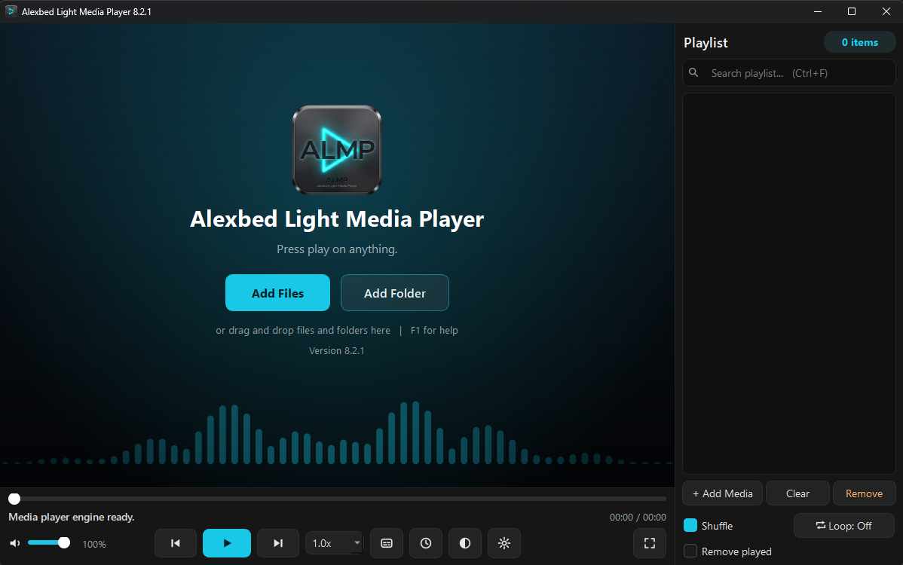

# ALMP v8.2.1

**Download:** `ALMP-v8.2.1-Portable.zip`
**SHA-256:** 423A516B69CEA61C41AD529286EE28C351BE1FEFE2148F1EC5E1D341B7391CA5

A small fix release for v8.2.0. Everything else is the same as v8.2.0
([v8.2.0 notes](v8.2.0.md)). ALMP still starts clean and never connects to the internet.

## Fixed
- **The title bar could go missing after leaving fullscreen.** Sometimes, after watching in fullscreen for a while
  and pressing `F` or `Esc`, the window came back without its title bar (no minimise, maximise or close buttons),
  and you had to press `F` twice to get it back. ALMP now returns from fullscreen in a single step (straight to
  maximised, or straight to the normal window size), and a moment later it checks the window and puts the title
  bar back if Windows left it off. When that happens, a line is written to the log
  (`%LOCALAPPDATA%\ALMP\almp.log`).

## Checked
- On a Windows 11 PC, with the real window and real mpv playing a video: 40 trips into fullscreen and back
  (20 from a maximised window, 20 from a normal window). The title bar was there after every one.
- The old v8.2.0 code also passed this short test, so it does not trigger the bug on demand (it seems to need
  longer playback). The fix was checked by removing a window's title bar on purpose and letting ALMP restore it.
- ruff and the test suite pass.

## For developers
- `almp/platform_win.py`: new `restore_window_frame(hwnd)`.
- `almp/ui.py`: `_toggle_fullscreen` makes one window-state change when leaving fullscreen; new
  `_check_window_frame` safety check 250 ms later.
- No new dependencies. libmpv pin unchanged.
