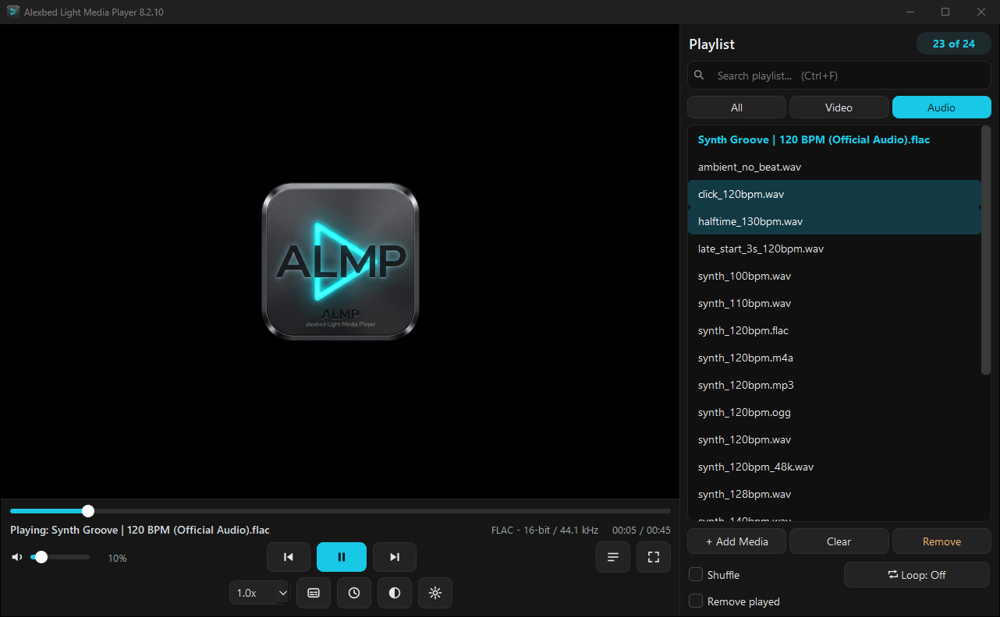

# ALMP v8.2.10

**Download:** `ALMP-v8.2.10-Portable.zip`
**SHA-256:** 72AE0D89331ECEE56565A3E1DB8E8C606963FA4567266B3B8190168F2A6EC638

## Fixed
- **The seek bar lands where you click or drag.** ALMP asked the playback engine for a fast seek, which
  jumps to the nearest keyframe *before* the spot. On Alexander's PC with 8.2.9, clicks on a 4-minute video
  landed 1.7 to 6.1 s early. Dragging still uses fast seeks so it stays smooth; letting go now seeks
  exactly. During a drag ALMP also uses the position the drag reports (it was one step behind).
- **A press next to the handle always starts a drag.** The bar works in whole seconds, so on a short track
  the handle can jump up to ~20 px away from the pointer; Qt then treated the press as a click beside the
  handle. Seen with the Linux style; not reproduced on Windows, fixed for both.
  Both were found by the real-mouse tests of the Linux port.

## Checked
- ruff and the test suite pass (332 tests; new: release seeks exactly, a drag seeks to the dragged value,
  a press beside the snapped handle still drags in the Fusion and Windows styles).
- Installed 8.2.10 on Alexander's PC, clicks sent to the seek bar of a paused 249 s video: landed 0.1 to
  0.7 s from the spot (8.2.9 on the same PC and video: 1.7 to 6.1 s early). A 45 s song: every click seeks.
- Same installed copy: window in 0.82 s; the ｜ video closes 0.20 s after 3 s with no freeze; Settings page
  dark (18,18,18) with Qt set to light and to dark; right-click entries still point to the installed copy.

## Not tested
- Dragging with a real mouse on Windows (clicks were sent to the window as mouse messages; the drag was
  checked with Qt events in the tests and with a real mouse on Linux).
