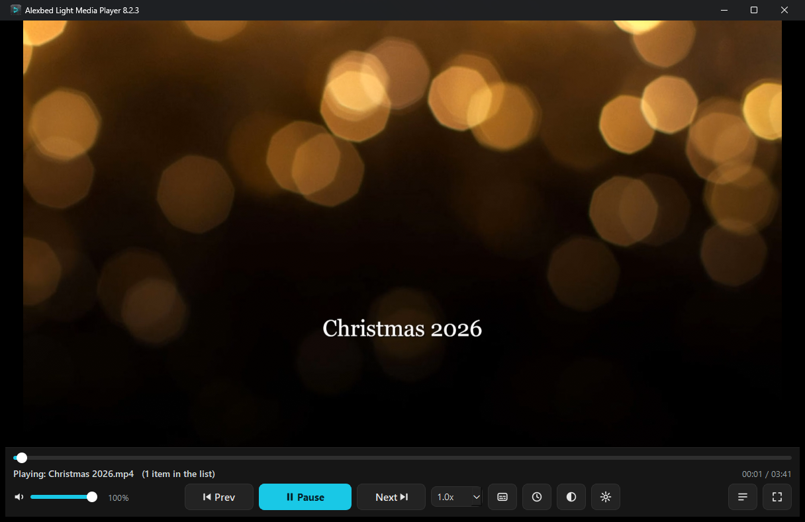
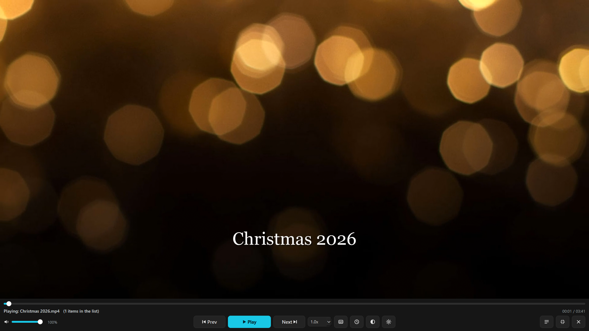
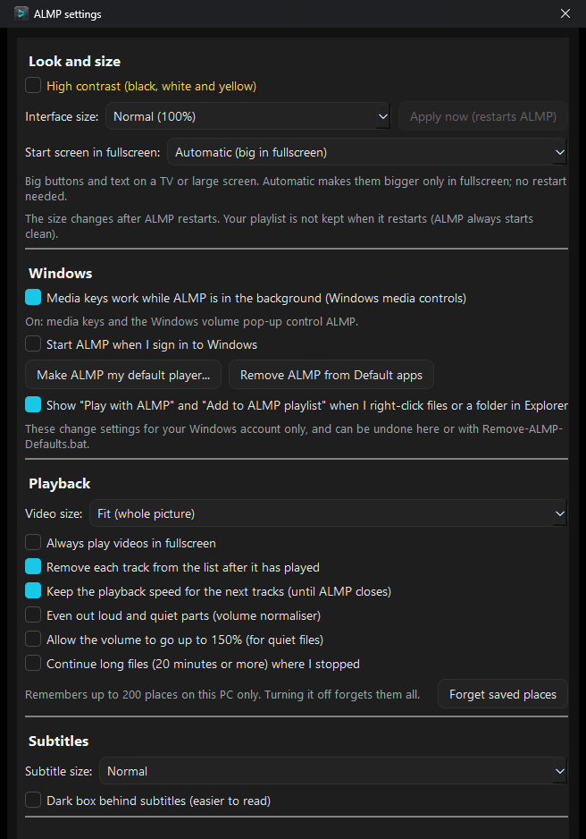

# ALMP v8.2.3

**Download:** `ALMP-v8.2.3-Portable.zip`
**SHA-256:** 2EBF1EC110199DB58568315A29C7B3EC8036E53484AFEE827DC0E4EEB56129AD

A fix release for v8.2.2, plus three small additions. Everything else is the same as v8.2.0 to v8.2.2
([v8.2.2 notes](v8.2.2.md)). ALMP still starts clean and never connects to the internet.

## Fixed
- **The first fullscreen could freeze for about 6 seconds and leave the control bar half drawn.**
  After pressing F (or double-clicking the video) the playlist and close buttons could be missing,
  the bar kept its narrow two-row layout, and the picture could sit in the wrong place until you
  left fullscreen and went back.

  **Why:** each time a window is maximized or made fullscreen, the Qt toolkit that draws ALMP
  redraws a hidden title bar in the "Segoe UI" and "Segoe Fluent Icons" fonts at *Thin* weight.
  Neither font has a Thin style, so Qt looked through every installed font for one: about 6.4 s on
  the test PC with 9,223 fonts. While it searched, ALMP could not finish laying out its window.
  The same happens with a plain Qt window, without any ALMP code.

  **What changed:** right after its window opens, ALMP gives Qt a Thin version of those two fonts:
  an in-memory copy of the PC's own font files from `C:\Windows\Fonts`, for ALMP only (about 15 ms).
  Nothing is installed in Windows and no font is shipped with ALMP. Only the hidden title bar uses
  it, so nothing in ALMP looks different.
- In fullscreen the right-hand part of the control bar is now always wide enough for its three
  buttons (playlist, leave fullscreen, close).
- The status line said "(1 items in the list)"; it now says "1 item".

## New
- **Settings > Playback > "Always play videos in fullscreen"** (off by default). Every video starts
  in fullscreen. Esc leaves fullscreen for that video; the next video starts in fullscreen again.
  Music is not affected.
- **A double-clicked video gets the whole window.** When ALMP is opened with one file, the playlist
  panel starts hidden. The playlist button (next to the fullscreen button) or **P** shows and hides
  it, now also outside fullscreen. When a second file is added, the panel comes back by itself
  (unless you hid it yourself). Opening a folder or several files shows the panel as before.
- **"Play with ALMP" and "Add to ALMP playlist" in the right-click menu for files.** Select one file
  or many (no 15-file limit) and right-click. *Play with ALMP* opens them in one ALMP window and plays;
  *Add to ALMP playlist* adds them and lets the current track keep playing (it starts playing if
  nothing is playing). Turn it on once in **Settings > Windows** (the same box as "Play with ALMP"
  for folders). On Windows 11 the entries are under "Show more options" (or Shift+F10), like other
  programs that are not installed from the Microsoft Store. If you had the folder entry turned on,
  ALMP adds the file entries by itself the next time it starts, and it keeps them pointing at the
  right ALMP.exe if you move the folder. `Remove-ALMP-Defaults.bat` removes them.

## Measured
Windows 11 PC, 4 logical cores, 32 GB RAM, 9,223 fonts installed, videos on a hard disk (HDD).

| | v8.2.2 | v8.2.3 |
|---|---|---|
| First fullscreen (F) | about 6.4 s frozen, bar half drawn | 0.12 to 0.22 s, all buttons |
| Window appears / video playing | 0.7 to 1.0 s / 1.5 to 2.2 s | unchanged |

What is still slow, and why:
- **File names with emoji or Chinese, Japanese or Korean characters.** The first time ALMP shows
  such a name, Qt looks through all installed fonts for one that has those characters. On the test
  PC the controls stopped responding for 7 to 9 s (once per run; the video itself keeps playing).
  Accented letters, Arabic and normal punctuation are fine. On a PC with a normal number of fonts
  this is short. Qt does this search before it uses its fallback fonts, so none of Qt's settings
  for fallback or emoji fonts avoided it (each was measured).

## Checked
- New tests: the Thin font copy (weight, names, original untouched, non-fonts rejected), the
  setting's default and validation, fullscreen bar room for three buttons in every layout,
  "Always play videos in fullscreen" (video yes, music no, off by default), the playlist panel for
  one file / a second file / a panel hidden by hand / leaving fullscreen, the right-click entries
  (both commands for every audio and video type, many files at once, every entry removed again,
  also by Remove-ALMP-Defaults.bat), "Add to ALMP playlist" keeping the current track playing.
- ruff and the test suite pass. Tested on the PC with real videos, one file and a 279-file folder.
- The built ALMP.exe: one double-clicked 4K video (window 0.7 s, playing 2.1 to 2.5 s after the
  first start), five files opened at once the way the right-click menu does (one window, 5 items),
  then "Add to ALMP playlist" with two more (7 items, the current track kept playing).

## For developers
- New `almp/titlefonts.py`: `thin_copy()` and `register_thin_title_fonts()`, called in `app.py`
  right after `window.show()` (the families must be loaded first; registering earlier made the
  first use of Segoe UI take 6.6 s).
- `ui.py`: `set_playlist_panel(visible, auto=False)`; P / playlist button work outside fullscreen;
  the right box of the bar is at least 148 px in fullscreen.
- `settings.py`: new `play_fullscreen` (default False).
- `platform_win.py`: `file_verb_entries()` / `file_verb_removals()` (HKCU\Software\Classes\
  SystemFileAssociations\<ext>\shell\ALMP.Play and ALMP.Add, MultiSelectModel=Player),
  `refresh_menu_entries()` at start; `set_folder_verb()` turns folder and file entries on/off together.
- `--add` on the command line (and as the first line of the message to a running ALMP): add the
  files without interrupting playback.
