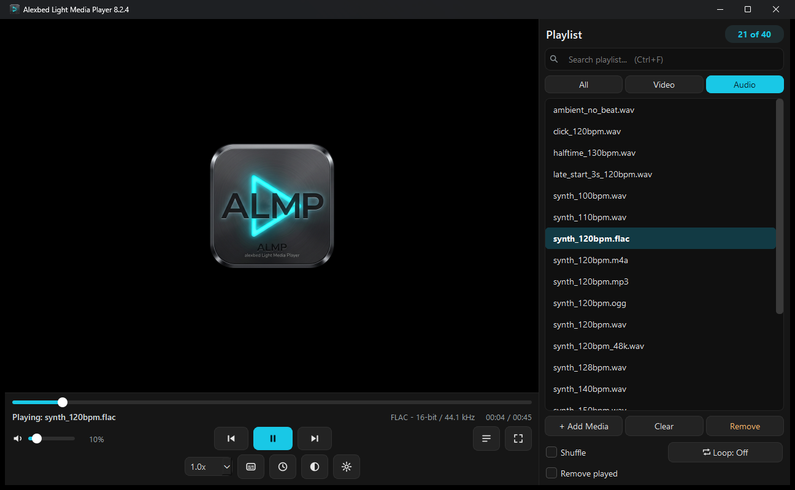
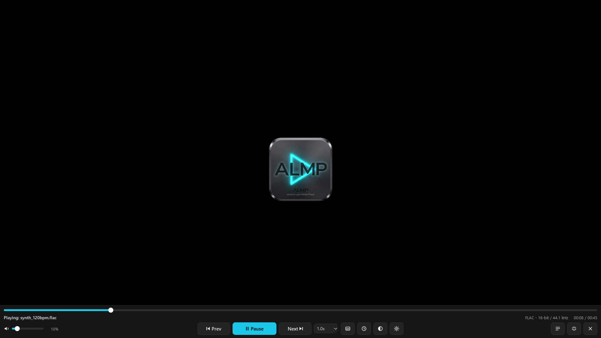
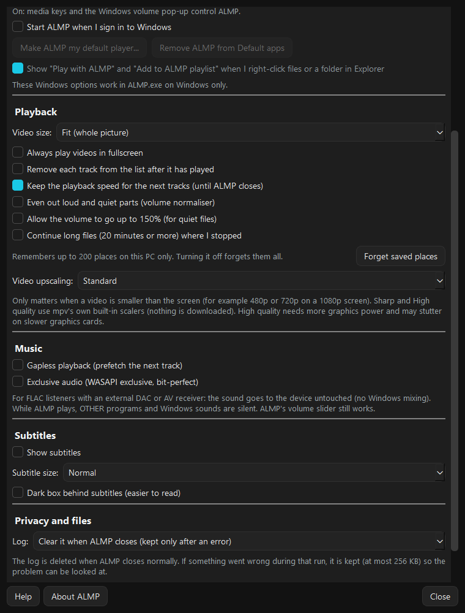

# ALMP v8.2.4

**Download:** `ALMP-v8.2.4-Portable.zip`
**SHA-256:** FD9C0FF11F0102C6F9315EDB4BCC4E5BF53CA27BC9A24BB0119F29C93E6D1F78

ALMP now keeps everything in its own folder, and adds a few things for music collections and films.
It still starts clean, keeps big playlists instant, and never connects to the internet.

## New
- **ALMP leaves nothing on the PC.** Settings, saved places and the log now live in a `Data` folder next
  to `ALMP.exe`. Deleting the ALMP folder removes everything. If that folder cannot be written to
  (Program Files, a read-only USB stick), ALMP uses `%APPDATA%\ALMP` and `%LOCALAPPDATA%\ALMP` as before,
  and Settings > *Privacy and files* says so.
  - **First start after updating:** `settings.json`, `positions.json` and `startup_target.txt` are copied
    from `%APPDATA%\ALMP` into `Data`, each copy is compared byte for byte, and only then are ALMP's own
    old files deleted by name (the same list as `Remove-ALMP-Defaults.bat`). The old folders are removed
    only if nothing else is in them. **Note:** an older ALMP (8.2.3 or earlier) started after that finds no
    settings and starts with its defaults.
  - The only things ALMP can still put outside its folder are the Windows entries you turn on yourself:
    Default apps / "Open with", the right-click menu entries, and the Run at Startup shortcut.
- **Small log, cleared on close.** At most 256 KB plus one older copy. Settings > *Privacy and files* >
  Log: *Clear it when ALMP closes* (default; kept if something went wrong during that run), *Keep the
  last run*, or *Off*.
- **Show subtitles (Settings > Subtitles).** Remembered between runs; **off by default**, also for people
  updating (subtitles are hidden until you turn them on once). The subtitles menu (right-click the video)
  uses the same setting: *Off* there unticks the Settings box, picking a subtitle turns it on. Loading a
  subtitle file turns it on.
- **All / Video / Audio** buttons under the playlist search: by file type (extension) only, no disk reads,
  together with the search.
- **Save playlist: Ctrl+S.** With a search or the Video/Audio filter on, only the shown items are saved
  (the dialog title says so).
- **Format of the playing track** next to the time, e.g. *FLAC - 24-bit / 96 kHz* (read from that one
  file only; nothing is scanned for the playlist).
- **Gapless playback** (Settings > Music, off by default): ALMP tells mpv which track comes next, so mpv
  reads it ahead and goes on without a gap.
- **Exclusive audio** (Settings > Music, off by default, remembered): WASAPI exclusive mode, bit-perfect,
  for external DACs and AV receivers. Other programs and Windows sounds are silent while ALMP plays.
- **Video upscaling** (Settings > Playback): *Standard* (as before) / *Sharp* (spline36) / *High quality*
  (ewa_lanczossharp + correct downscaling, sigmoid upscaling, debanding). mpv's own built-in scalers only;
  nothing is downloaded or bundled. Changes apply at once.
- **Help > About** shows the Releases page address with a **Copy link** button (copies the text only;
  ALMP opens nothing and checks nothing; there is no update check).

## Fixed
- **Fullscreen with music: the controls did not appear when the mouse moved** (only F worked). The album
  art covers the video area and did not pass mouse moves on. It now does: the controls show on mouse
  move and hide after 3 seconds, the same as for video. Checked with real mouse moves on
  FLAC -> video -> FLAC in fullscreen.
- **About ALMP showed no "Playback engine" line** (mpv and FFmpeg versions). It does again.

## Checked, no change needed
- **Fullscreen with a mixed playlist** (video -> FLAC -> video): ALMP stays fullscreen, shows the album
  art (or the ALMP logo on dark) for music, and the next video plays fullscreen again.

## Measured
Windows 11 Pro, 4 logical cores, 32 GB RAM, GTX 960, 1920x1080 screen.

| | v8.2.3 | v8.2.4 |
|---|---|---|
| 100,000-file playlist: first track / whole list | 0.347 s / 1.71 s | 0.347 s / 1.78 s |
| Search "e" in 100,000 files | 13.0 ms | 13.2 ms |
| Sort 100,000 by name (background) | 1.30 s | 1.25 s |
| Window stall p99 during the scan | 22.7 ms | 23.5 ms |
| New All/Video/Audio filter, 25,000 / 100,000 files | - | 3.5-3.7 ms / 7-9 ms (first use 15.6 / 42 ms) |
| Built ALMP.exe: window shown / video playing | 0.7 to 1.0 s / 1.5 to 2.2 s | 0.7 s / 1.6-1.7 s |

The playlist numbers are within normal run-to-run noise. One small slowdown: *Reverse the order* on
25,000 items went from 13.6 to 17.3 ms. The very first start, which also moves the old settings into
`Data`, took 1.3 s / 2.4 s.

**Video upscaling**, fullscreen on the 1080p screen, 10 s per level: mpv reported **0** dropped or delayed
frames at every level. GPU = average 3D-engine use of ALMP (Windows counters, noisy):

| Video | Standard | Sharp | High quality |
|---|---|---|---|
| 360p30 (hardware decoding) | 12% | 18% | 43% |
| 720p25 (software decoding) | 19% | 23% | 12% |

High quality roughly triples GPU work on low-resolution video: smooth on this GTX 960, may stutter on weak
laptop graphics (the Settings text says so). The default stays Standard. The 720p row looks odd because
that clip used software decoding and the counter only sees the GPU part; trust the 360p row more.

## What we did not test
- **Gapless and exclusive audio** were checked with the real mpv (the next track started with no reload by
  ALMP; exclusive mode ran on WASAPI), but we did not do a listening test for gaps or try an external DAC
  or AV receiver ourselves.
- Exclusive mode while another program already holds the sound device exclusively.
- The Data folder logic on Linux by hand (it is shared code and covered by tests).

## Checked
- ruff and the test suite pass (306 tests, 59 new for 8.2.4).
- The built ALMP.exe: `Data` appears next to it, old 8.2.3 settings are moved in (volume kept), the old
  folders are removed, and after a normal close only `Data\settings.json` is left.
- Alexander's own test of the 8.2.4 build on his PC.

## For developers
- New `almp/datafolder.py` (migration), `paths.py` chooses the Data folder (`ALMP_DATA_DIR` overrides it),
  `logsetup.py` (size cap, clear/keep/off).
- python-mpv: `player["x"]` reads and sets only mpv *options*; runtime properties (`audio-params`,
  `mpv-version`, ...) must be read as attributes (`player.audio_params`).
- `settings.py`: `show_subtitles`, `log_mode`, `gapless`, `audio_exclusive`, `upscaling`.
