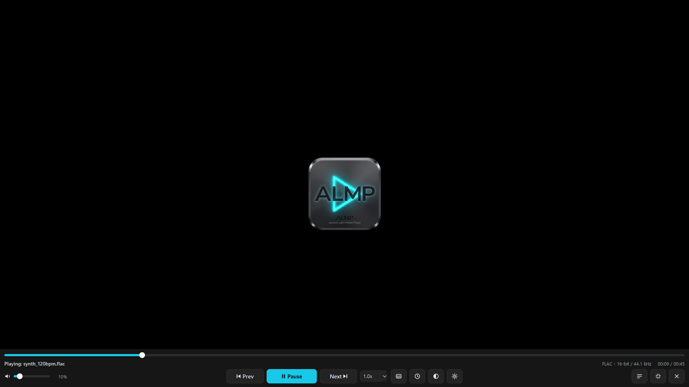
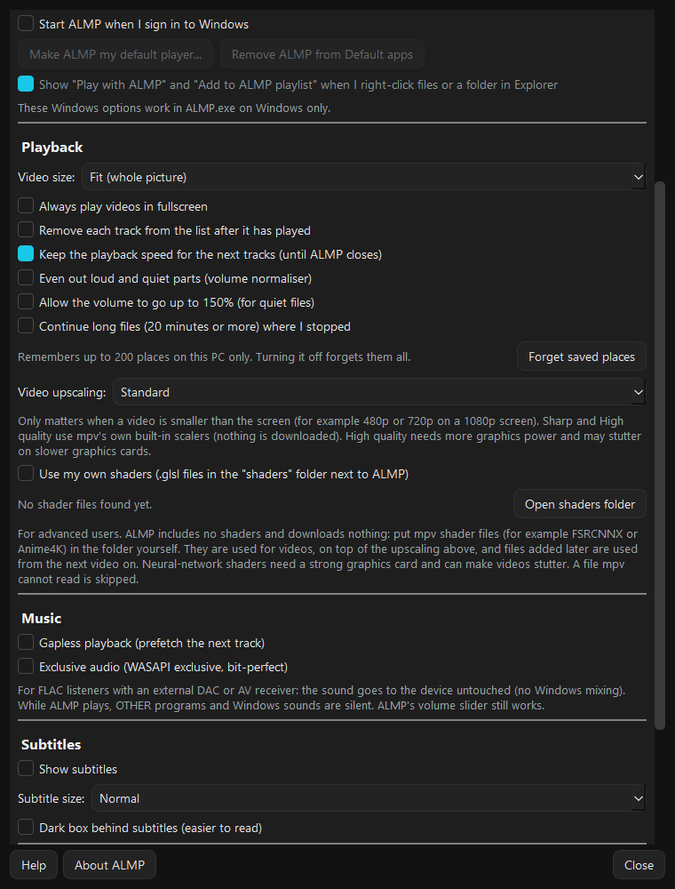

# ALMP v8.2.5

**Download:** `ALMP-v8.2.5-Portable.zip`
**SHA-256:** SHA_PLACEHOLDER

A small update to 8.2.4: you can now select several playlist items at once and remove or delete them
in one go. Everything new in 8.2.4 is still here; see the [8.2.4 notes](v8.2.4.md).

## New
- **Select several playlist items.** Ctrl+click adds or removes one item, Shift+click (or Shift+Up/Down)
  selects a range, Ctrl+A selects everything. Until now only one item could be selected.
  - **Delete** removes all selected items from the list; the files stay on disk. Removing tens of
    thousands of items is one step.
  - **Shift+Delete** asks **once** for all of them (showing the first five names) and sends them to the
    Recycle Bin. If some are on a USB stick, memory card or network drive (no Recycle Bin), the question
    says how many will be deleted **permanently**. Files that cannot be deleted stay in the list, and one
    message names them.
  - **Right-click** inside the selection keeps it and offers *Remove N items*, *Copy N file paths* and
    *Delete N files*.
  - If the playing track is among them, the next track plays.

## Not changed
- Dragging to reorder still moves one item at a time. With several items selected, a drag does nothing.

## Checked
- ruff and the test suite pass (314 tests, 8 new: removing and deleting several, with a search active,
  with the playing track among them, a failed delete, no Recycle Bin, and real Ctrl / Shift clicks).
- Removing 50,000 of 100,000 items from the list data: under 2 s in the test (one pass, not one by one).
- Alexander's own test of the build on his PC (select several, remove, delete).
- The built ALMP.exe shows 8.2.5 and starts normally.
