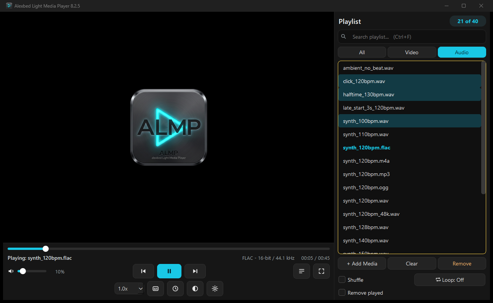

# ALMP v8.2.5

**Download:** `ALMP-v8.2.5-Portable.zip`
**SHA-256:** SHA_PLACEHOLDER

A small update to 8.2.4: you can now select several playlist items at once and remove or delete them
in one go, and advanced users can add their own video shaders. Everything new in 8.2.4 is still here; see the [8.2.4 notes](v8.2.4.md).

## New
- **Select several playlist items.** Ctrl+click adds or removes one item, Shift+click (or Shift+Up/Down)
  selects a range, Ctrl+A selects everything. Until now only one item could be selected.
  - **Delete** removes all selected items from the list; the files stay on disk. Removing tens of
    thousands of items is one step.
  - **Shift+Delete** asks **once** for all of them (showing the first five names) and sends them to the
    Recycle Bin. If some are on a USB stick, memory card or network drive (no Recycle Bin), the question
    says how many will be deleted **permanently**. Files that cannot be deleted stay in the list, and one
    message names them.
  - **Right-click** inside the selection keeps it and offers *Remove N items*, *Copy N file paths* and
    *Delete N files*.
  - If the playing track is among them, the next track plays.
- **Your own video shaders (optional, for advanced users).** Settings > Video upscaling > *Use my own shaders*
  (off by default). Put mpv shader files (`.glsl` or `.hook`, for example FSRCNNX or Anime4K) in a `shaders`
  folder next to `ALMP.exe`; *Open shaders folder* creates it and opens it. They are used for videos, on top of
  Standard / Sharp / High quality, in name order (at most 16), and files added later are used from the next
  video on. ALMP includes no shaders and downloads nothing, so it stays small and offline, and there are no
  extra licences in the zip. A file mpv cannot compile is skipped by mpv: the video keeps playing.

## Not changed
- Dragging to reorder still moves one item at a time. With several items selected, a drag does nothing.

## What we did not test
- **No real neural-network shader (FSRCNNX, Anime4K) was tried**: ALMP does not download anything, so the
  test used two small shader files written for the test. With the real mpv on a 360p video: a valid
  pass-through shader and a deliberately broken one were both handed to mpv; the broken one gave a compile
  error in mpv's log, and in all four cases (none / valid / broken / both) the picture kept showing with
  0 dropped frames. How fast FSRCNNX or Anime4K run depends on the shader and the graphics card; they are
  much heavier than High quality and can stutter on older cards.

## Checked
- ruff and the test suite pass (318 tests, 12 new: removing and deleting several, with a search active,
  with the playing track among them, a failed delete, no Recycle Bin, real Ctrl / Shift clicks, and the
  shaders folder: finding files, the mpv commands, off by default, live on/off, Settings text).
- Removing 50,000 of 100,000 items from the list data: under 2 s in the test (one pass, not one by one).
- Alexander's own test of the build on his PC (select several, remove, delete).
- The built ALMP.exe shows 8.2.5 and starts normally.
