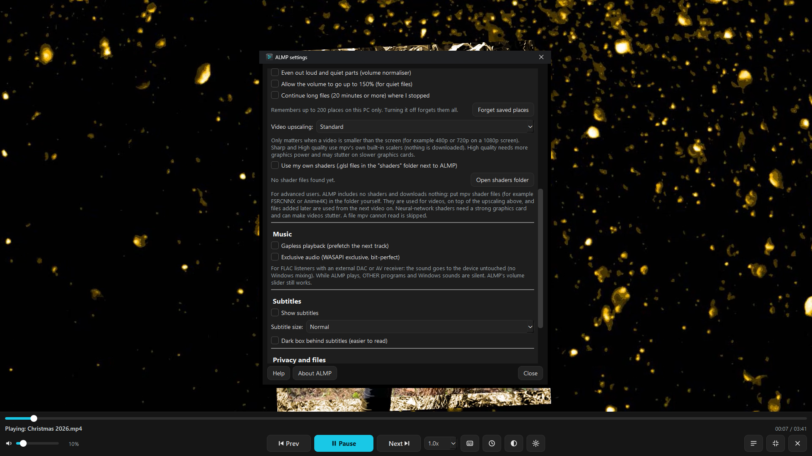
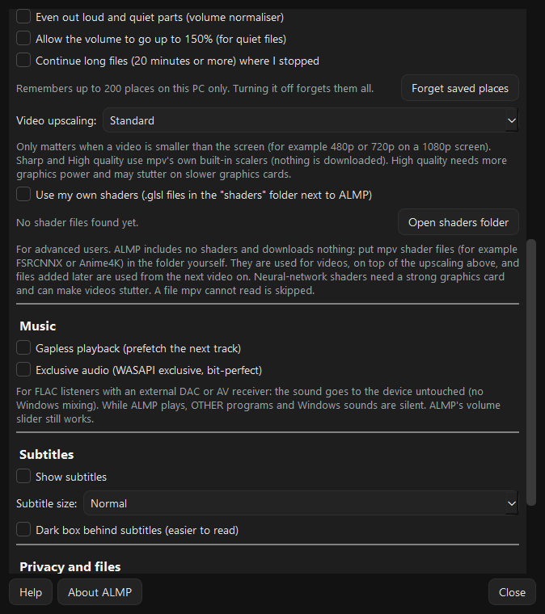

# ALMP v8.2.6

**Download:** `ALMP-v8.2.6-Portable.zip`
**SHA-256:** 9B818BF01C8DCB07774F391BC581F7D37AAA452BB2E04F5BC745052EDB783E86

A fix for 8.2.5. Everything new in 8.2.5 is still here; see the [8.2.5 notes](v8.2.5.md).

## Fixed
- **The player's buttons ignored the mouse while Settings was open.** Settings blocked the whole
  player. In fullscreen the control bar stayed on screen and looked usable, but Pause, Next, leave
  fullscreen and even the close button did nothing until Settings was closed, so ALMP seemed frozen.
  Settings now stays open beside the player: everything else keeps working, and Settings stays on top
  of a fullscreen video. Clicking the gear again brings the same Settings window to the front.
- **Text in Settings was cut off on the right** (for example the "Open shaders folder" button). The
  window is now wide enough for its widest line (never wider than the screen).

## Known limit
- If you change something from the player's right-click menu (for example the video size) while
  Settings is open, Settings shows the change only after you open it again.

## Checked
- ruff and the test suite pass (319 tests, 1 new: Settings open in fullscreen does not block the
  player, opens only once, and closes cleanly).
- By hand with the mouse in fullscreen, on Alexander's PC: 8.2.5 reproduced (close button did nothing
  while Settings was open); with the fix, Pause, leave fullscreen and the close button all worked with
  Settings open.
- The built ALMP.exe from this zip, on Alexander's PC: title shows 8.2.6; in fullscreen with Settings
  open, Play and the close button worked with the mouse.
- FSRCNNX_x2_16-0-4-1.glsl from the shaders folder on two low-resolution videos (480p and 360p) at
  1920x1080 on a GTX 960: loaded, 0 dropped frames.

## Not tested
- Anime4K shaders, and FSRCNNX on longer or higher-resolution videos.
