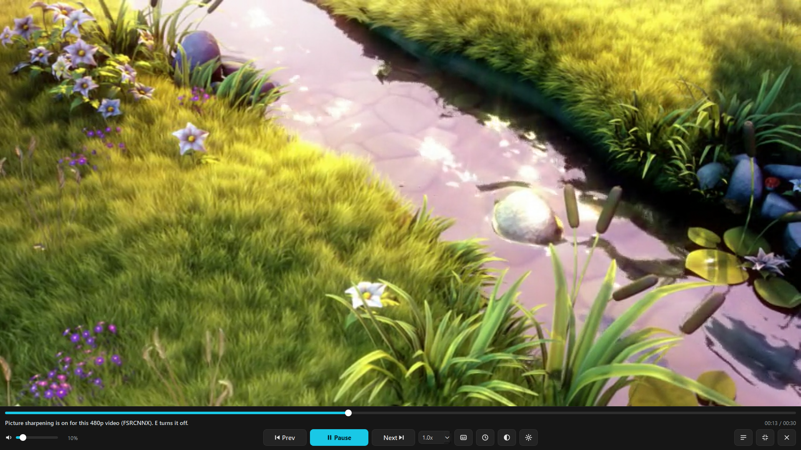
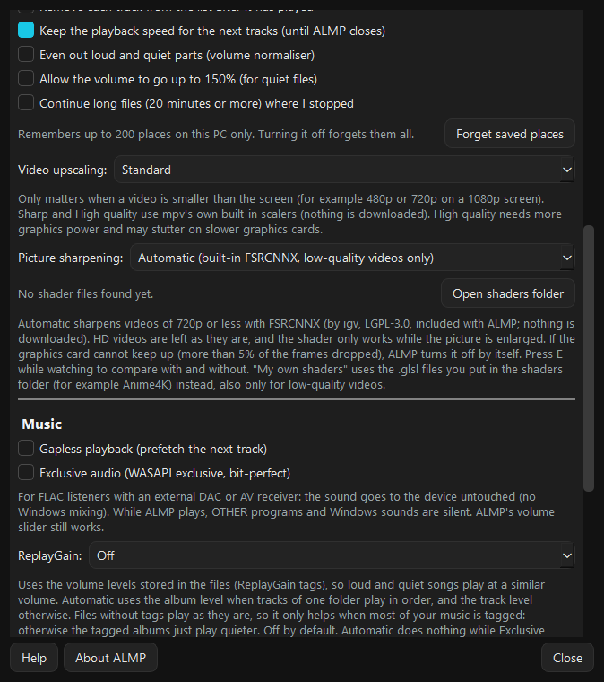

# ALMP v8.2.7

**Download:** `ALMP-v8.2.7-Portable.zip`
**SHA-256:** BC184C61890614BE49DF4EB1743ABDFF79327984CC4267983E8474DC04CD10F7

Sharper low-quality videos (on by default) and optional ReplayGain for music (off by default).

## New
- **Sharper low-quality videos.** ALMP now includes one shader file, FSRCNNX x2 (by igv, LGPL-3.0-or-later;
  nothing is downloaded). It is used only for videos of 720p or less, and only while the picture is
  enlarged (for example a 480p video on a 1080p screen). HD videos are left exactly as they were.
  - **E** turns it off for now and on again, so you can compare.
  - If the graphics card cannot keep up (more than 5% of the frames dropped in 6 seconds of playback),
    ALMP turns it off by itself for the rest of the run and says so. E tries again.
  - The first time on a PC the picture can stand still for about 3 seconds while mpv prepares the shader.
    mpv keeps the prepared shader in a new `shader-cache` folder inside ALMP's `Data` folder, so later it
    takes about 1 second (measured on a GTX 960: 3.2 s, then 1.2 s).
  - Settings > Playback > **Picture sharpening**: Automatic (default) / My own shaders / Off.
    "My own shaders" (the 8.2.5 `shaders` folder) now also applies only to videos of 720p or less.
    If you had "Use my own shaders" ticked in 8.2.5, it becomes "My own shaders".
- **ReplayGain (optional, off by default).** Music files with ReplayGain tags can play at a similar volume.
  Automatic uses the album volume when tracks of one folder play in order (so an album keeps its loud and
  quiet songs), and the track volume when shuffling. Files without tags play as they are. With Exclusive
  audio (bit-perfect) on, Automatic does nothing. Settings > Music > **ReplayGain**: Off (default) /
  Automatic / Track / Album.
  - Why off by default: on Alexander's library (1,347 files in 182 folders) 130 folders carry 0 dB
    placeholder tags and 43 have none; only 9 have real values (-1.6 to -13.5 dB). With ReplayGain on,
    those 9 albums simply played quieter than everything else. It helps only when most music is tagged.
    One compilation even had an album value of -13.5 dB on every track (the quietest track's value).
    "Even out loud and quiet parts" (the volume normaliser) works without tags.

## Checked
- ruff and the test suite pass (324 tests; new: sharpening only for low-quality videos, the frame-drop
  switch-off and the start-up burst it ignores, the E key, own shaders, ReplayGain choices, the
  Settings controls, and settings migration from 8.2.5).
- Real mpv on Alexander's PC (GTX 960, 1920x1080):
  - 480p video in fullscreen: FSRCNNX loaded; after the one-off start (56 frames dropped while the shader
    was prepared), 0 frames dropped. 1080p video: no shader. Without the shader: 0 dropped.
  - ReplayGain: a track tagged -6 dB plays at 0.501x, its album tag -3 dB at 0.708x, exactly as tagged.
    In the real ALMP window on Nana Ampadu's "Evergreen Tunes, Vol. 1": album volume in order, track volume
    for another album and when shuffled, none with Exclusive audio.
  - The installed 8.2.7 on Alexander's PC, with real mouse and keys: 480p and 360p videos sharpened, E off/on, 1080p video
    "not needed".

## Not tested
- Weaker graphics cards (laptops with built-in graphics), where the automatic switch-off should step in.
- Anime4K in "My own shaders".
