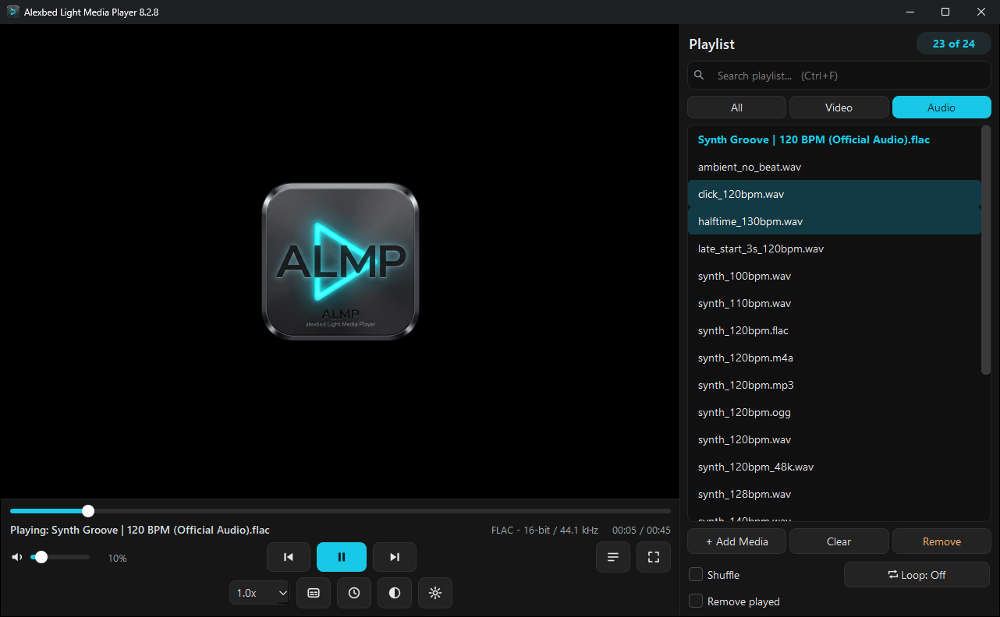
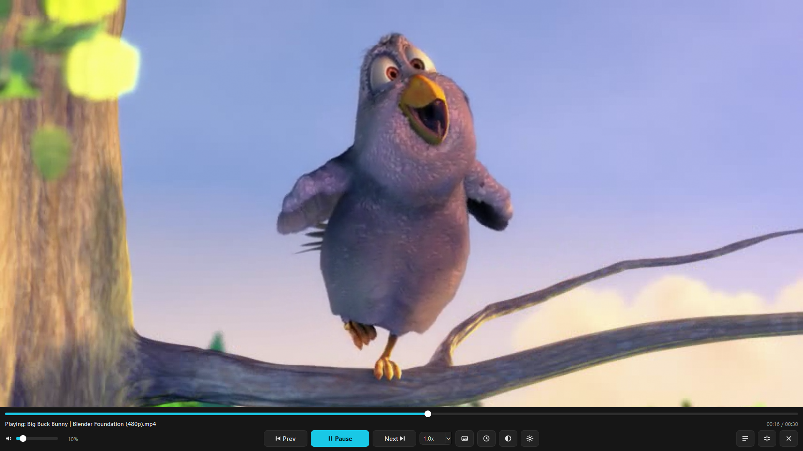

# ALMP v8.2.8

**Download:** `ALMP-v8.2.8-Portable.zip`
**SHA-256:** 026BDC08BF5B3EF91E9A335607181C46DF36BAB481DF29F5C1F88BC856F65C01

## Fixed
- **One taskbar button.** With ALMP pinned to the taskbar, playing a file opened a second ALMP button next to the pin. ALMP no longer gives its window its own taskbar ID, so Windows puts the window on the pinned icon (any pin of ALMP.exe or a shortcut to it).
- **No freeze with full-width characters in file names.** Download tools often write "｜", "＂", "？" instead of the characters Windows does not allow. Windows' normal UI font has none of them, so Qt searched every installed font: on a PC with 6,674 font families the window froze for about 14 s right after such a file started (closing it then looked like a hang: 21 s). ALMP now shows them as plain | " ? (the file is not renamed). Closing right after opening such a video: 21 s -> 0.35 s.

## Checked
- ruff and the test suite pass (327 tests; new: no own taskbar ID, full-width names shown as ASCII while the
  playlist keeps the real path).
- On Alexander's PC with the installed 8.2.8 and a real taskbar pin: started from the pin, a song opened while
  ALMP was open, and a song opened while it was closed: one taskbar button each time (8.2.7: two).
- Opening a 1080p video named with "｜" and closing ALMP after 3 s: 0.23 to 0.33 s to close (8.2.7: 21 s,
  with the window frozen for about 14 s). Plain names were not affected before or after.

## Not tested
- Pins made from the Start menu, and other PCs.
- File names in Chinese, Japanese or Korean (or rare symbols): Windows' UI font lacks those too, so on a PC
  with thousands of fonts the first such name can still pause ALMP once for a few seconds.
