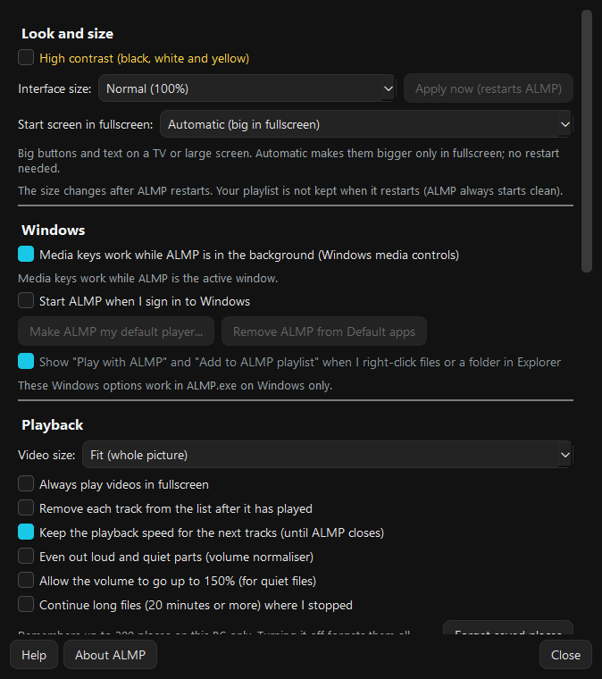

# ALMP v8.2.9

**Download:** `ALMP-v8.2.9-Portable.zip`
**SHA-256:** 12CD4A4378A382DC53544732C8B49FD63F9B5C5AE7D2852E9A385F97289D51F6

## Fixed
- **Settings was hard to read when Windows uses light mode.** The page inside the Settings window took
  Windows' near-white light colours (243,243,243) under ALMP's light text, so headings such as "Windows"
  and "Playback" almost vanished. The page now always uses ALMP's own dark (or high-contrast black)
  background. Dark mode looked right before and looks the same now. Found while porting ALMP to Linux.

## Checked
- ruff and the test suite pass (329 tests; new: the Settings page has the theme background, in normal and
  high-contrast mode).
- Settings drawn with Qt set to light and to dark: light page 243,243,243 before, 18,18,18 after; dark
  mode unchanged.
- CHECKS_PLACEHOLDER

## Not tested
- Switching the real Windows theme to light on Alexander's PC (the light look was tested by setting Qt's
  colour scheme in a test copy run from source).
