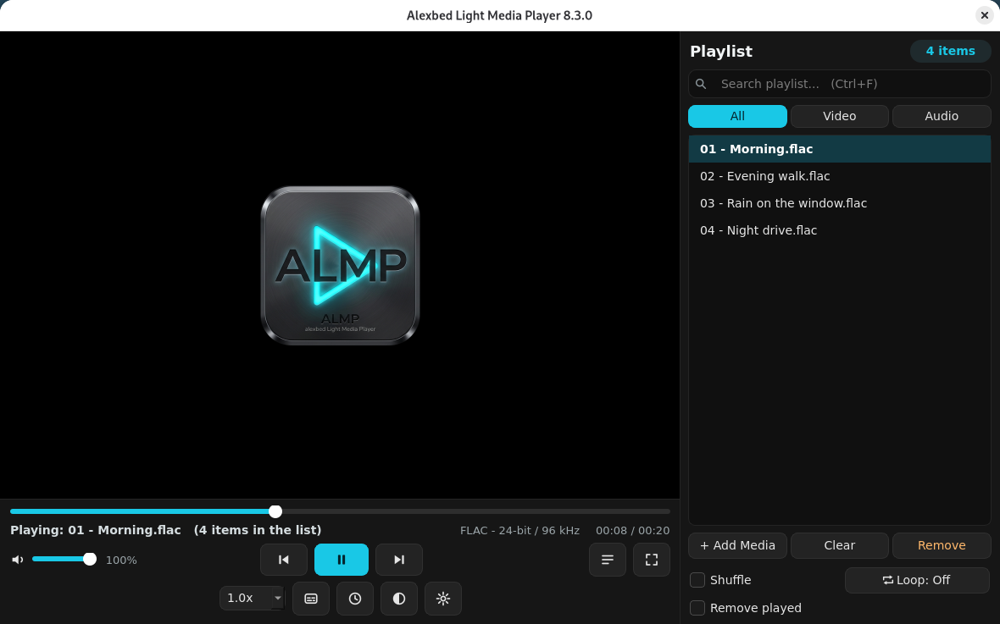

# ALMP v8.3.0: ALMP for Linux

**Downloads**
- Windows: `ALMP-v8.3.0-Portable.zip`
  SHA-256: `21E0717A148F23BF897892E00A6E0FF0A59CBA64DADB02A1D5D9E998510FFB7F`
- Linux: `ALMP-v8.3.0-Linux-x86_64.tar.gz` (new)
  SHA-256: `710a92dfafb03248d2e8f674cfc8887cab4ac9012ef50346dc666f4711f0ffef`

## New: ALMP for Linux
- **Portable, nothing to install:** unpack the `.tar.gz` and double-click `ALMP`. The playback engine (mpv 0.37
  with FFmpeg) is inside the folder. Runs on Linux Mint 22, Ubuntu 24.04, Debian 13 and newer (64-bit, glibc 2.39
  or later). Check the download with `sha256sum -c ALMP-v8.3.0-Linux-x86_64.tar.gz.sha256.txt`.
- The same player as on Windows: huge playlists, search, filters, fullscreen with auto-hiding controls,
  subtitles, sharpening, ReplayGain, sleep timer, high contrast, continue long files.
- **Linux parts (Settings > Linux):** app-menu entry and "Open With", "Make ALMP my default player" (60 audio and
  video types), start at sign-in, background media keys and the desktop's media panel (MPRIS: title, artist,
  album, cover). Deleted files go to the desktop's Trash.
- **Exclusive audio** (Settings > Playback): straight to a device (HDMI to a TV or receiver, analog, USB DAC),
  bit-perfect, or through PipeWire in exclusive mode. If the device is busy, ALMP says so and plays through PipeWire.
- Works on X11 and Wayland desktops (on Wayland through XWayland, so the video stays inside ALMP's window).
  The window frame is dark where the desktop allows it (Cinnamon); GNOME draws its own frame.

## Windows
- No change in behaviour; the zip is the same player as 8.2.10 with the new version number.

## Checked
- ruff and the test suite: 430 tests on Windows, 432 on Linux (CI runs both on Windows and Ubuntu).
- **Windows**, installed copy updated to 8.3.0 (8.2.10 backed up first, Data kept, all 77 files compared): window
  in 0.7 to 0.8 s, a video playing after 1.4 to 1.5 s (3.3 s on the first, cold run), FLAC 24/96 plays, a video
  with a full-width name closes 0.28 s after closing, "Play with ALMP" still points to the installed copy.
- **Linux, built program** (the tar.gz):
  - Debian 13 GNOME (Xorg): 19 built-program checks, 28 smoke checks, 12 checks with a REAL mouse and keyboard
    (pointer in fullscreen, Play/Pause, wheel, right-click menu, double-click in and out of fullscreen, seek-bar
    drag, Next/Prev), exclusive audio 4/4 (PipeWire exclusive, direct device, busy device falls back, off).
  - Ubuntu 26.04 GNOME (Wayland) with no mpv installed: 19/19 and 12/12 with a real (kernel) mouse and keyboard.
  - Linux Mint 22.3 Cinnamon on a real PC with a TV over HDMI: 20/20 (bundled engine, sound to HDMI, media panel
    with artist and cover, dark frame, video inside the window) and 12/12 with real input. Sound on the TV was
    heard (by a person) with the previous test build, not re-listened with 8.3.0.
  - A bare Ubuntu 24.04 without mpv: every library found, the engine loads and plays.

## Not tested
- KDE, Xfce and other desktops; Fedora, Arch, openSUSE; HiDPI screens; NVIDIA/AMD graphics and hardware decoding
  (tested on Intel and virtual graphics); real USB sticks (Trash); drag and drop of files.
- Exclusive audio has not been listened to yet: it was checked in a virtual machine whose sound card is silent
  (the device was opened, held and released correctly; the fallback works).
- Linux Mint (Cinnamon 6.6) sends the keyboard's media keys to the first media player it saw; with a browser's
  media tab open, the keys can go to the browser instead of ALMP. The panel's sound applet controls ALMP.
- Dragging the seek bar with a real mouse on Windows (checked with Qt events in the tests and with a real mouse on Linux).

## Why 8.3.0
A new platform and new features are a minor version, not a fix release. Windows users can skip 8.3.0:
nothing changes there.
